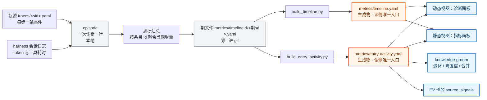

# 诊断可观测性：本地件、指标、面板与上仓

一次诊断会留下轨迹、报告、证据、缓存与账单。哪些只在这台机器上有意义、哪些要作为仓库资产提交、后者长什么样、以及两者各自被谁读——这四件事原先散在多个 skill 正文、脚本注释与面板代码里。本文是它们的单一定义处，同时给出目标态：三种粒度的底账、每个指标要回答的问题、两类视图，以及指标随知识上仓的形态与节律。

读者是要改轨迹字段、指标口径、面板呈现、本地件落点或知识整理流程的人。读之前需要知道诊断六步各写什么（[diagnosis-trace.md](../../skills/diagnose/references/diagnosis-trace.md)）、现有指标怎么算（[metrics.md](../guide/metrics.md)）、机制层怎么演化（[rsi-mechanism.md](rsi-mechanism.md)）。只想拿到一次诊断结论的工程师不必读。

取舍与被否决的方案在 [ADR-0011](../adr/0011-diagnosis-observability-data-plane.md)。

## 1 解决什么问题

这个数据面要解决的问题分两半：**文件该落在哪**，与**落下的记录能不能支撑改进**。

### 1.1 文件该落在哪：三类事故

一张面是仓库资产：进 git、走 PR、所有人共享。另一张是本地件：只在这台机器的这份检出里有意义。边界没有一处写全时，出现三类事故，都实测过。

1. **记录写错位置**。在 worktree 里按正文写的相对路径写轨迹，文件落进 worktree 自己的忽略目录；主检出的面板与周批读不到它，而 `git worktree remove` 对忽略件不报错、也不提示，记录随 worktree 一起消失。
2. **把读不到当成没有**。在 worktree 里跑周批，`traces/` 是空的，`scripts/trace_metrics.py` 报「未找到任何 traces/*.yaml」却照常产出空快照；`scripts/settle_s2_feedback.py` 的 glob 在目录不存在时返回空，报 0 条结算、退出码 0——读的人分不出「这批样本都没有结论」与「结果文件在另一个检出」。
3. **同一个量各算一遍**。会话成本有四个来源（提供方账单、skill 执行流水的 `cost` 字段、改进项卡的 `actual_cost.tokens`、skill 常驻上下文的审计值），含义不同、互不换算；「命中」也有三处口径（案例本体的 `confidence.hits`、期文件的 `tier2_hit`、`trace_metrics.py` 的现算值）。

### 1.2 落下的记录能不能支撑改进：四个现象

1. **过程侧记录很密，但没有读端回答「这一次值不值」**。本机 18 份轨迹里 242 条事件、agent 动作 16 类；它们有词表校验、有面板渲染，却没有一处折算出这次诊断的步数、成本、无效动作与触达的知识。
2. **仓库里那份汇总不带条目归属**。期文件里唯一按 id 记的是 `metrics.reference_detail`（某条先验被引用几次、其中几次解决）；案例侧没有对应块，`scripts/settle_trace_feedback.py` 自己记着「数据都在 traces 里，但没有任何脚本产出它」。
3. **定义了却没有决定读它的指标有 6 个**：漏检类别、漏检会话、先验三态、停止原因分布、同批并发标记、候选全集事件——有产出、在白名单里，8 期期文件一个都没写过。归因比则有判据、有生产者，读端读错了键，恒为 0。
4. **结局侧几乎没有输入**：三期 live 快照的反馈捕获都是 0，命中率、误诊率、校准因此只能标不可解读。

**明确不解决**：不改诊断流程内部的执行规则（那在 `skills/diagnose/` 正文里）；不引入向量检索（[ADR-0002](../adr/0002-retrieval-no-rag-lightweight-index.md)）；不让 agent 改指标口径与评分定义；不做跨部署读数合并。

## 2 最小可执行模型

**本地件与仓库资产的分界只有一条判据**：这份文件换到另一份检出、另一台机器上还有没有意义。有意义的是仓库资产，没有意义的是本地件。

本地件的落点分两种：**要被同一克隆的多个检出共读的锚在主检出**；一次批次用完即弃的留在检出内。锚定由三部分组成，缺任何一部分都会重新出现 1.1 的第一类事故：

1. 一张本地件路径表：`scripts/exec_log_path.py` 的 `CHECKOUT_DIRS` 与 `resolve_*` 函数。
2. 一个给 agent 用的命令行入口：`python3 scripts/shared_dir.py <名字>`。
3. 一条写作纪律：skill 正文里的本地件路径一律用解析后的绝对路径。

在这条判据之上，观测按**三种粒度**组织，**两张视图**都由它派生：

| 粒度 | 是什么 | 键 | 谁写 | 进 git |
|---|---|---|---|---|
| episode | 一次诊断的全部观测（路由、行为、成本、结局、触达的知识） | `session_id` | 诊断收尾时由脚本从轨迹与账单汇总 | 否（含客户现场信息） |
| entry activity | 某个知识条目（案例 id 或先验 id）在一期内的使用增量 | 条目 id × 期号 | 知识整理流程在周批里写 | 是 |
| period | 一个部署机在一期内的全部读数 | 部署 × 期号 | 组装脚本产出骨架、人复核分母 | 是 |

- **动态视图**：一次诊断的 episode 摊开给人看——走对了没有、钱花在哪、哪些动作是白做的。
- **静态视图**：多期 entry activity 与 period 合并后的顶部条目与越界项——热点案例、热点先验、热点过程动作、正在腐化的条目。



**图 1　三种粒度与两张视图（类型：数据流图；范围：从一次诊断的原始记录到面板与演进消费，省略结构侧与评测侧指标）**

图例：灰色是底账与源（`episode` 在本地，期文件进 git），橙色是生成物，蓝色是消费方。图中省略了全部被忽略规则挡在仓外的中间文件。

这张图里值得注意的地方：**两张视图取的是同一份数据**。同一次诊断在诊断面板里是「这一次怎么走的」，它的条目触达在指标面板里是「这些条目又被用了一次」；两者对不上时是聚合脚本的问题，不是两份数据的问题。

## 3 完整机制

### 3.1 本地件清单与锚定

锚定一列写「主检出」的走 `CHECKOUT_DIRS` 或对应的 `resolve_*` 函数。写「检出内」的不锚主检出，解析路径的基准有两种：多数读端按当前工作目录解析，`scripts/evolution_health.py` 按脚本所在检出解析。

| 本地件 | 路径 | 谁写 | 锚定 | 进 git |
|---|---|---|---|---|
| 诊断轨迹 | `traces/<session_id>.yaml` | diagnose 每步 | 主检出 | 否 |
| 定位报告 | `traces/<session_id>.report.md` | diagnose 收尾 | 主检出 | 否 |
| 证据原件 | `traces/evidence/<session_id>/` | diagnose | 主检出 | 否 |
| 交接单与导出 | `traces/handoff/<sid>.yaml`、`traces/exports/` | `import_trace.py`、`export_trace.py` | 主检出 | 否 |
| 沉淀草稿 | `postmortems/inbox/<case-id>.md`、`.case.yaml` | `to-postmortem`、`issue-ingest` | 主检出 | 否 |
| 源码缓存 | `src-code/<version>/` | `src_fetch.py` | 主检出 | 否 |
| 上游文档缓存 | `ref-docs/` | `reference-ingest`、`gc_docs.py` | 主检出 | 否 |
| 结算游标 | `.settle-state.json` | 两个结算脚本 | 主检出 | 否 |
| skill 执行流水 | `metrics/skill-exec-log.yaml` | `log_skill_exec.py` | 主检出 | 否 |
| 改进项实测记录 | `metrics/ev-measure-log.yaml` | `ev_measure.py --run` | 主检出 | 否 |
| 演进会话与评审 | `proposals/{sessions,tasks,reviews,experiments}/` | `self-evolve` | 主检出 | 否 |
| 摄取台账 | `ingest-state.json`、`reference-ingest-state.json` | `issue-ingest`、`reference-ingest` | 仓根 | 是 |
| 验证回放产物 | `.s2-replay/` | `s2_replay.py`、`eval_arena.py` | 检出内 | 否 |
| 交互回放产物 | `.ixn-replay/` | `ixn_replay.py` | 检出内 | 否 |
| 回放输入与报告 | `.replay-input/`、`.replay-report.md`、`.flow-replay/` | `replay_golden.py`、`flow_pool.py` | 检出内 | 否 |
| 自动抓取候选 | `.auto-fetch/` | `auto_fetch.py` | 检出内 | 否 |
| 调研物料 | `research/` | 人 | 检出内 | 否 |

`traces/` 与 `diagnosis_state*.yaml` 在 `.gitignore` 的前几行，其余各自有注释行。锚定的适用范围是「同一克隆且能取到 git」：`scripts/exec_log_path.py` 在没有 git 环境时退化为检出内，多份克隆之间也互不可见，两种情况都在输出里标出退化形态。

两个场景各有一个坑。**在 worktree 里干活**：worktree 没有主检出那份 `traces/`、`postmortems/inbox/` 与 `proposals/` 运行时目录——忽略件不随 worktree 创建而复制；写相对路径的记录会进 worktree 那一份，清理时一起消失。**跨机器接手**：`export_trace.py` 在 `traces/exports/` 下产出压缩包与说明，另一台用 `import_trace.py` 落位并在 `traces/handoff/` 留交接单；比对的锚点是 `kb_rev`，两台的 `kb_rev` 不一致时候选集会不同，口径见 [handoff.md](../guide/handoff.md)。

### 3.2 谁在什么时候读哪份本地件

本地件被消费有两种模式。脚本读的读法确定、输入确定、输出确定，可以配门；agent 读的读法随现场变化，只能靠正文约束。这条区分决定哪些改动能进 CI：`scripts/` 下的确定性读端可以，skill 正文里的读法只能靠评审。

| 消费方 | 时点 | 读什么 | 入口 |
|---|---|---|---|
| diagnose | 步骤 3 相似检测 | 历史轨迹 | `shared_dir.py traces` |
| to-postmortem | 收尾 | 来源轨迹 | 草稿头的 `source_session` |
| 各内容 skill | 收尾 | 无（只写执行流水） | `log_skill_exec.py` |
| knowledge-groom | 反馈结算 | 轨迹里的 `feedback` 事件 | `settle_trace_feedback.py`、`.settle-state.json` |
| knowledge-groom | 验证结算 | `.s2-replay/*.result.yaml` | `settle_s2_feedback.py` |
| knowledge-groom | 引用可观测性与夹具预核 | 轨迹里的 `reference_lookup`；轨迹 | `trace_metrics.py`、`replay_trace.py --emit-fixtures` |
| evolve-check | 内容流程收尾 | 执行流水；归因事件与容量判据 | `tail_exec_log.py`、`component_tally.py`、`metrics_health.py` |
| self-evolve | 深度轮 | 时序数据、执行流水、归因、验证待办、会话状态 | `metrics_health.py --json`、`s2_replay.py --todo` |
| skill-review | 显式触发 | 执行流水、skill 上下文成本 | `audit_skill_cost.py`、`tail_exec_log.py` |
| resume-diagnosis 与诊断面板 | 开屏 | 自己的轨迹与交接单 | `shared_dir.py traces`；面板自身的 `fs.resolve('traces', {cwd})` |

面板那一行与其余各行不同：它不调用 `shared_dir.py`，读的是当前会话的工作目录。在 worktree 里开面板，看到的是 worktree 的 `traces/`。锚定是脚本侧的保证，不覆盖面板的轨迹读，这一条列在 5.2。

### 3.3 指标的存在条件与清单

一个指标进得了这套机制，只有当它能填满五格。填不满就删掉——这是「每个指标的作用」的落地方式，也是 1.2 第三、四个现象的解法。

| 格 | 要写什么 |
|---|---|
| 读它的人 | 具体角色，不是「所有读者」 |
| 做什么决定 | 一个可以执行的决定 |
| 读数为坏时的下一步 | 一条命令或一个动作 |
| 分母与覆盖 | 分母是什么、覆盖哪批会话、哪份检出 |
| 观测强度 | 确定性 / 代理 / 自报 / 人工 |

观测强度按 [design-principles.md](../spec/design-principles.md) 第十条标档，并**写进数据**（每个指标一个字段），不写在注释里：`确定性`（脚本或账单直接产出）、`代理`（用可计算的量代替真量）、`自报`（agent 自己记的）、`人工`（现场回报）。

| 指标 | 读它的人 → 决定 | 坏时的下一步 | 分母与覆盖 | 强度 | 现状 |
|---|---|---|---|---|---|
| 路由准确率 | 维护者周批 → 改 triage 词法与命名空间归属 | 看漏检类别，补路由词或挪分类 | 已判定路由的会话 | 确定性 | 已有 |
| 候选召回 / 命中位次 | 维护者 → 补案例或改排序键 | 看漏检样本落在哪个格子 | 有预期答案的回放样本 | 确定性 | 已有（离线） |
| 兜底使用与挽救 | 维护者 → 判是覆盖缺口还是要新先验 | 缺口补案例；流程问题改正文 | 全部诊断会话 | 确定性 | 已有 |
| 先验读取三态与消费点 | 词条作者 → 该查没查改流程、查了没用改词条 | 按三态分流 | 走先验读取步骤的会话 | 确定性 | 已有 |
| 漏检类别 | 维护者 → 补词法或挪类别 | 按类别补 triage 词 | 未路由命中的会话 | 确定性 | 字段有、无读端 |
| 步数与动作分布 | skill 维护者 → 改哪一步的正文 | 出现最多却不推进的动作优先改 | 全部诊断会话 | 确定性 | 已有（事件计数） |
| 分步成本（token 与工具耗时） | 维护者 → 裁最贵的步骤 | 定位最贵步骤，看能否合并或跳过 | 有 harness 会话日志的会话 | 确定性 | 缺失 |
| 一次诊断读入账 | 维护者 → 治超预算的读路径 | 按四个分项定位该治哪条 | 全部诊断会话 | 确定性 | 已有 |
| 停止原因 | 维护者 → 判断该不该停在这里 | 未记录的会话先补记录 | 全部诊断会话 | 确定性 | 字段有（覆盖 2/18） |
| 无效探索 | 维护者 → 换探索策略 | 在历史决策树上离线打分（见 3.7） | 历史决策树，同策略对照 | 代理 | 缺打分本体 |
| 词表合规 | 维护者 → 补词表或改记法 | 违规事件逐条看 | 全部事件 | 确定性 | 已有 |
| 反馈捕获 | owner → 判学习环有没有输入 | 为 0 时命中率、误诊率标不可解读 | 给出结论的会话 | 确定性 | 已有（三期 0） |
| 现场解决计数 | 排序与退休 → 降置信或退休 | 连续两次未解决转人工 | 已回报的会话 | 人工 | 已有（`hits>0` 仅 2 条） |
| 外部对照闭环 | owner → 内容正确性的独立确认 | 没有上游锚点的案例标不可对照 | 有上游 issue 或 PR 锚点的案例 | 确定性 | 缺失 |
| 归因比 | owner（误诊修复前必读）→ 改知识还是改流程 | 先补归因事件再修 | 已归因的误诊 | 人工 + 脚本 | 读错键恒 0 |
| 结论强度分布 | owner 与面板读者 → 哪些结论不能当依据 | 弱强度结论不得升格 | 给出结论的会话 | 确定性 | 字段有（草稿期） |
| 条目使用增量 | groom → 退休、降置信、合并、补样例 | 高选中低解决 → 复审该条 | 该条目的当期被选中数 | 确定性（本部署） | 缺失（本次新增） |
| 长期零命中条目 | groom → 不退休或补词面 | 复查症状词面与标签 | 全库条目 | 确定性 | 缺失 |
| 格子读入成本 | 维护者 → 拆分、瘦身、按平台切 | 看格子的实读 token | 无分母（绝对量） | 确定性 | 已有判据 |
| 草稿校验通过率 | owner → 草稿质量门 | 补齐草稿缺的节 | inbox 草稿 | 确定性 | 已有 |
| 相似条目对 | groom → 合并压缩 | 逐对判 | 整理流程检出的对数 | 代理 | 缺失 |
| 改进项积压 | owner → 超限量即停产新项 | 先补合入指针 | 无分母（绝对量） | 确定性 | 已有判据 |
| 预测实测三态 | 评审者 → 卡可不可信 | 补跑判据或补预期 | 卡数 | 确定性 | 已有 |
| 采纳与拒绝比 | owner → 系统有没有拒绝路径 | 拒绝为 0 时质疑采纳记录 | 终态卡 | 确定性 | 已有 |

同一个量只允许一处定义。新指标落地时先回答「它与表里哪一行是同一个量」，是同一个就改那一行，不新增。

### 3.4 动态视图：一次诊断

诊断面板展开一张卡时，除现有的结论与轨迹之外，按下面的顺序补五块。每块回答一个判断，缺数据时显示「这次没记」，不显示 0。

1. **结论与强度**：结论一句话、命中案例 id、结论强度档（来自草稿期的 `verification.source`，不是 `confidence.score`）。
2. **步带**：事件按步排成一条横带，每格一个动作；深浅表示该步成本占比，并行分组并排，返工（同一动作重复、候选重新展开）加标记。
3. **检索走向**：候选池里被展开、被排除、被命中的各是哪些 id；先验读取的三态与消费点。
4. **成本条**：三分 token（未缓存输入 / 缓存读写 / 输出）、工具耗时占比、一次诊断读入账的四个分项。数据来自 harness 会话日志，不由 agent 自报。
5. **缺口提示**：这次没记录的字段逐条列出（停止原因、反馈、归因等），并给补记入口。

### 3.5 静态视图：持续上仓

指标面板首屏按「先回答四个问题、再看趋势」组织：**样本覆盖是多少、哪个读数不可解读、哪条知识在腐化、本周该做什么**。

- **热点案例与热点先验**：按当期被选中次数排序的顶部条目，每条带选中次数、解决次数、最后命中期、来源检出。冷条目单列——长期零选中不是「没用的知识」的证据，罕见但正确的条目不退休（[ADR-0004](../adr/0004-capacity-governance.md) 的软退休）。
- **热点过程动作**：动作分布 × 成本占比。它回答「诊断的钱主要花在哪一步」，是改 skill 正文的直接输入。
- **腐化带**：被检索但长期不解决、长期冷、格子读入成本越界、期文件断档，四类各一行，每行带判据出处与下一步动作。
- **趋势**：现有期序列照旧；每格必须能答「向哪个方向是坏」，面板不按正负号着色。
- **每张卡带五格**：3.3 那张表在界面上的投影——读它的人与决定、坏时的下一步、分母与覆盖、强度档、最后更新期。

静态视图上每个「坏」的读数都指向一类动作，不经人转抄：

| 读数 | 指向的演进动作 |
|---|---|
| 条目高选中、低解决 | 案例复审、降置信、补样例 |
| 长期零选中 | 补症状词面与标签；不据此退休 |
| 相似条目对 | 合并压缩 |
| 某一步占比高且常返工 | 改该 skill 正文 |
| 漏检类别集中 | 补 triage 词或挪分类 |
| 兜底使用持续偏高 | 补案例（覆盖缺口）或补先验 |
| 无效探索的展开量偏高 | 换探索策略（闸门满足后） |
| 改进项积压超限 | 停产新项，先补合入指针 |

### 3.6 上仓形态与节律

进仓库的四类形态各有落点与更新方式：

| 形态 | 落点 | 更新方式 |
|---|---|---|
| 单条知识的持久状态 | 案例的 `confidence` 与 `validation_record` | 周批结算，走知识修改 PR |
| 条目使用增量 | 期文件 `metrics.entry_activity` 段 | 一期一文件，随期文件一起提交 |
| 周期聚合读数 | `metrics/timeline.d/<期号>.yaml` 与生成物 `metrics/timeline.yaml` | 一期一文件，聚合是生成物 |
| 判据数值 | `metrics/gates.yaml`、`proposals/gates.yaml` | 机制变更时改 |

新台账只记「被选中」，不记「现场确认解决」——后者是案例 `confidence.hits` 的职责。两者的边界是：**选中不等于命中**。

```yaml
# metrics/timeline.d/<期号>.yaml 的 metrics 段内
metrics:
  entry_activity:                     # 键 = 案例 id 或先验 id；只写当期有活动的条目
    VLLM-ASC-12430: {selected: 3, loaded: 2, resolved: 1, misdiagnosed: 0}
    msllm-startup-version-env-triage: {lookups: 4, hit: 3, miss: 1, purpose: {signature: 3, background: 1}}
```

四条约束决定了这个形状：**一期一文件**（同期的两个写入者不撞在一起，撞号由现有后缀机制处理；按 id 一个文件则同一 id 的历史跨期写同一文件，冲突时没有确定性重建命令）；**源文件可以写数字**（「生成物里不写数字」约束的是生成物，仓根的 `ingest-state.json` 是同类先例）；**与知识本体解耦**（只写 id 键的观测，不改 `knowledge/` 下的案例文件）；**放在 `metrics:` 段内**（面板的期文件解析器是手写的，会把 `metrics` 上下文里缩进不超过四层的行折进 `metrics`，段内与既有 `reference_detail` 同构，段外的顶层键会被误当成指标行渲染）。

读侧新增生成物 `metrics/entry-activity.yaml`，跨期求和，面板与 groom 只读它。**读数按部署分家**：本台账同 `metrics/timeline.d/`，是这份检出自己的使用史；不同部署的数字不合并，`sources` 里写明哪份检出、当时的 `kb_rev`、覆盖的期。

节律上两种做法回答的不是同一个问题，因此不做二选一：

| | 周期（现状） | 事件驱动 | 本设计 |
|---|---|---|---|
| 触发 | 每周任一人跑周批 | 每次诊断或每次整理 | 周期跑整体读数，条目增量随整理流程提交 |
| 谁复核分母 | 人（不可退） | 无 | 人复核整体读数；条目增量由脚本产出、groom 核对 |
| 好处 | 趋势可比、分母有人看过、PR 量可控 | 因果链短，指标与知识同一 PR | 趋势照旧，条目级观测与知识变更同行 |
| 坏处 | 条目级观测到不了仓库 | 分母碎片化、趋势要重拼、PR 量按单增长 | 期文件变大，新增段要同步多处 |
| 不选另一案的理由 | 只留事件驱动会撞已否决的一条（每次诊断单独开 PR） | 只留周期则条目被检索的证据到不了退休决定 | — |

节点落在：诊断收尾不写仓库（`episode` 留本地）；周批由任何人跑一次，组装整体读数与当期条目增量，两部分写进同一个期文件，随一个 PR 进 git。

### 3.7 无效探索：只做机械化的一半

「这次诊断有没有白走的路」是本设计里唯一需要新概念的指标。本仓已有的外部研究给了做法与边界（[rsi-mechanism.md](rsi-mechanism.md) 第 12 节 Dream-RSI 一行）：一条完整的历史是精确的重放器，换一种探索策略在同一棵决策树上走不同分支，结果已在盘上、评估零执行；但**前提是策略为可重算的代码**，把历史抽象成方向性洞见注入提示词，同预算下不如不注入。

因此拆成两半，各自记各自算：

- **机械化的一半（可离线打分）**：展开几个候选、以什么顺序、哪些同批并行、在哪里停。原料在轨迹里已有三个字段——顶层 `stop_reason`、事件级 `parallel_group`、`considered_candidates`，它们就是为这件事预留的。读数形式是**同一棵历史决策树上两种策略到达命中所需的展开量之差**，不是「无效步数」。
- **语义的一半（在线判断）**：某个假设被哪条证据推翻、为什么换方向。只有在线能判，记法可以是 agent 显式写下的一条事件，也可以是 `reason` 里的散文；它**不与机械一半合成一个数**，两者强度与可比性不同。

闸门：打分本体在**任一部署机的轨迹达到 30 条且反馈捕获率大于 0** 之前不写（[ADR-0009](../adr/0009-counterfactual-replay-exploration-policy.md) 的重评条件；当前主检出 18 条、反馈捕获 0）。在此之前只做两件事：保证三个原料字段继续被记录；面板如实显示「本项缺打分本体」。

## 4 边界与失败模式

| 情形 | 行为 |
|---|---|
| 反馈捕获为 0 | 命中率、误诊率、校准一律标不可解读，不写 0；面板明说「不是零问题，是没有数据」 |
| 某个指标本期没有数据 | 不写该键；面板显示「本期未采集」 |
| 某台机器没有某类记录 | 覆盖声明里写明，不把「本机没遇到过」写成「全库没人用」 |
| 某一期缺 `entry_activity` | 该期不参与条目累计，聚合脚本如实报缺哪几期，不按 0 计 |
| 条目 id 在知识库里不存在 | 报孤儿键（案例已删除或改名），不计入热点，列入清理清单 |
| 面板读不到生成物 | 显示「生成物缺失」与重建命令，不回退到原始期文件自行求和 |
| 无 git 环境或在 worktree 里跑周批 | 沿用现有退化：路径退化为检出内并在输出里标出；不产出空指标 |
| 多个 worktree 并发写同一期 | 期号冲突由现有后缀机制处理；不同期不同文件 |
| 结论强度是 agent 自报 | 强度档写进数据，面板标明「自报」，不与确定性读数同权 |
| 事件列表键名不认识 | 报该会话事件未记录，并在比例读数旁标出分母构成 |

## 5 现状

### 5.1 已落地

- 本地件锚定表与两个缓存根的解析：`python3 scripts/shared_dir.py --list` 列出名字，`python3 scripts/shared_dir.py traces` 打印主检出下的绝对路径。
- 轨迹与事件的词表校验、证据落盘、报告模板：`skills/diagnose/references/diagnosis-trace.md`。
- 三块组装与周批流程、判据三态：`scripts/metrics_snapshot.py`、`scripts/metrics_health.py`，口径见 [metrics.md](../guide/metrics.md)。
- 期文件与生成物分离、期号命名、字段白名单：`scripts/build_timeline.py`、`scripts/verify_metrics.py`。
- 一次诊断的读入账四个分项与格子读入成本线：`scripts/index_read_cost.py`、`metrics/gates.yaml`。
- 先验按 id 的明细：期文件的 `metrics.reference_detail`。
- 反馈结算把现场回报写回案例置信度：`scripts/settle_trace_feedback.py`。
- 确定性读端的复核命令：`settle_trace_feedback.py --audit`、`component_tally.py`、`check_handoff.py`、`node scripts/session_cost.mjs --all`。
- 无 git 环境下的退化路径与标签：`scripts/exec_log_path.py`。

### 5.2 蓝图

| 蓝图项 | 落点 | 确认方式 |
|---|---|---|
| 期文件新增 `metrics.entry_activity` 段（当期增量，id 键） | `scripts/metrics_snapshot.py`、`scripts/verify_metrics.py` 白名单 | 组装一期骨架，段内出现当期有活动的条目 |
| 条目累计的生成物与聚合脚本 | 新增 `scripts/build_entry_activity.py` → `metrics/entry-activity.yaml` | 跑一次聚合，顶部条目与期文件增量逐条对得上 |
| 孤儿键与缺期报出 | 同上 | 造一个不存在的 id，聚合时报孤儿并列出所在的期 |
| 分步成本（token 与工具耗时）接入 episode | `scripts/session_cost.mjs` → 汇总脚本 | 对最近一次诊断跑一次，输出三分 token 与工具耗时 |
| 动态视图五块（结论强度、步带、检索走向、成本条、缺口提示） | `dsh-plugins/ascend-panel/` 前端与 host | 在真实轨迹上打开一张卡，五块都能显示或显示「这次没记」 |
| 静态视图四问与五格 | 同上 | 首屏能答四个问题；每张卡带五格 |
| 面板解析器支持条目段 | `panel-host.js` 的期文件解析 | 喂一期含 `entry_activity` 的文件，条目不被当成指标行渲染 |
| 外部对照自动查证（开源 issue 类） | 新增脚本，复用 `gh api` 外壳与结算回写通道 | 对一个有上游锚点的案例跑一次，写出结局并留在 `validation_record` |
| 面板的轨迹读跟随会话工作目录 | `panel-host.js` 的 `resolveCwd` | 在 worktree 里开面板，看读到的是哪一份 `traces/` |
| 指标强度档写进数据 | 期文件与面板 | 每个指标能读出强度档，面板标明「自报」 |
| 无效探索的离线打分 | 尚未立项，闸门见 3.7 | 闸门满足后另行起卡 |

### 5.3 已否决

各自的代价与不选的理由在 [ADR-0011](../adr/0011-diagnosis-observability-data-plane.md)：把条目使用增量写进案例文件；按 id 一个文件；做成仓根状态文件；每次诊断的指标单独开一个 PR；只保留周期节律或只保留事件驱动；把语义与机械两半合成一个「无效探索次数」；让 agent 自动判定现场结局；在面板里自行求和期文件；把验证回放产物 `.s2-replay/` 收进主检出锚定表；把检索的查询串、topK 与分数写进轨迹；把 token 与耗时写进轨迹事件；给案例加状态字段表达生命周期；把诊断标签扩成多个人工枚举。

## 6 代码与文档入口

| 用途 | 入口 |
|---|---|
| 本地件锚定表 | `scripts/exec_log_path.py` 的 `CHECKOUT_DIRS` 与 `resolve_*`；agent 入口 `scripts/shared_dir.py` |
| 轨迹字段与事件词表 | `skills/diagnose/references/diagnosis-trace.md`、`diagnosis_state.yaml.example`、`trace-status.yaml` |
| 指标口径与周批流程 | `docs/guide/metrics.md` |
| 期文件组装与体检 | `scripts/metrics_snapshot.py`、`scripts/metrics_health.py`、`metrics/gates.yaml` |
| 期文件校验与聚合 | `scripts/verify_metrics.py`、`scripts/build_timeline.py` |
| 诊断侧现有读数 | `scripts/trace_metrics.py` |
| 条目增量（新增） | `scripts/trace_entry_activity.py`、`scripts/build_entry_activity.py` |
| 一次诊断读入账 | `scripts/index_read_cost.py` |
| 反馈与验证结算 | `scripts/settle_trace_feedback.py`、`scripts/settle_s2_feedback.py` |
| 会话账单 | `scripts/session_cost.mjs` |
| 面板 | `dsh-plugins/ascend-panel/README.md`、`dsh-plugins/ev-panel/README.md` |
| 跨机交接 | `docs/guide/handoff.md`、`scripts/export_trace.py`、`scripts/import_trace.py` |
| 演进消费点 | `skills/evolve-check/SKILL.md`、`skills/self-evolve/SKILL.md`、`skills/knowledge-groom/SKILL.md` |

## 7 外部参考

适用性判断与全表见 [rsi-mechanism.md](rsi-mechanism.md) 第 12 节。与本文直接相关的三条：

- Dream-RSI（arXiv 2609.14858）：历史树离线重放、策略须可重算；历史抽象成洞见注入提示词不如不注入。3.7 只做机械化一半的依据。
- Library Drift（arXiv 2605.19576）：不维护的知识库会漂移到注入反而更差，过早退休同样有害。热点视图不把「零选中」读成「无用」的依据。
- Falsifiable Release Gates（arXiv 2607.13070）：不能报错的检查与没有检查在观测上无法区分。每个读数要求「坏时的下一步」的依据。
