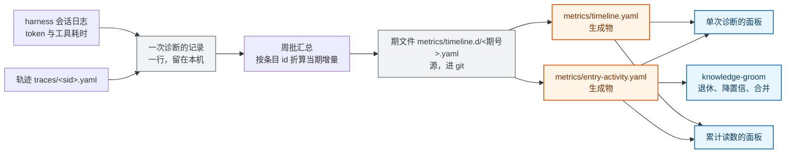

# 一次诊断记录什么、怎么上仓

诊断在本机跑，记录也留在本机；进仓库的只有汇总后的读数。本文说明一次诊断产出哪些文件与字段、这些记录怎么攒成可以提交的形式、以及在多人、多 worktree、多次回报的条件下怎么不出冲突。

读者是要改轨迹字段、上仓脚本、面板或知识整理流程的人。前置有三件：诊断六步各写什么，见 [diagnosis-trace.md](../../skills/diagnose/references/diagnosis-trace.md)；指标怎么算，见 [metrics.md](../guide/metrics.md)；机制层怎么演化，见 [rsi-mechanism.md](rsi-mechanism.md)。只想拿到一次诊断结论的工程师不必读。

取舍与被否决的方案在 [ADR-0011](../adr/0011-diagnosis-observability-data-plane.md)。

## 1 解决什么问题

这套记录要被问到五个问题。前三个今天答不了，后两个没有设计。

1. 一次诊断产出什么数据、什么产物、记哪些字段。
2. 本机跑了十次诊断，怎么变成仓库里的一份读数。
3. 观测数据与案例库、先验库是否解耦，加观测要不要动知识条目。
4. 多人提 PR 时，同一条案例的读数变化会不会撞车，改动面有多大。
5. 工程师回报「解决 / 没解决」时，读数能不能跟着准确更新。

现状是：轨迹记了 242 条事件，但没有任何读端把它折成一次诊断的成本与触达；仓库里那份汇总不带条目（期文件里按 id 记的只有 `metrics.reference_detail`）；六个指标有产出、在字段白名单里，8 期期文件一个都没写过；归因比读错了键，恒为 0；三期 live 快照的反馈捕获都是 0，命中率和误诊率因此没有分母。

本文不解决四件事。诊断流程内部的执行规则在 `skills/diagnose/` 正文里。检索不上向量库（见 [ADR-0002](../adr/0002-retrieval-no-rag-lightweight-index.md)）。指标算法与评分定义只有人能改。读数不做跨部署合并。

## 2 最小可执行模型

记录分三层，只有后两层进仓库。

| 层 | 内容 | 键 | 谁写 | 进 git |
|---|---|---|---|---|
| 一次诊断 | 这次诊断的路由、行为、成本、结局、触达的知识 | `session_id` | 收尾时由脚本从轨迹与会话日志汇总 | 否，含客户现场信息 |
| 条目使用 | 某个案例或先验在一期内的使用增量 | 条目 id × 期号 | 知识整理流程在周批里写 | 是 |
| 期 | 一个部署机在一期内的全部读数 | 部署 × 期号 | 组装脚本出骨架，人复核分母 | 是 |



图 1　一次诊断的记录与上仓（类型：数据流图；范围：从本机记录到面板与知识整理，省略结构侧与评测侧指标）

图例：灰色是本机记录与期文件源，橙色是生成物，蓝色是消费方。

两块面板取同一份数据：单次诊断的面板摊开这一次，累计读数的面板合并多期（被用得最多的案例与先验、最花成本的过程动作、正在变差的读数）。

## 3 完整机制

### 3.1 一次诊断产出什么

一次诊断在本地留下四样东西，第五样是本设计要补的。

| 产物 | 路径 | 内容 |
|---|---|---|
| 轨迹 | `traces/<session_id>.yaml` | 顶层字段加事件列表，每步一条 |
| 报告 | `traces/<session_id>.report.md` | 人读结论，与轨迹同目录 |
| 证据原件 | `traces/evidence/<session_id>/` | 工程师贴回的日志、截图 |
| 会话账单 | DSH 会话日志 | 提供方 usage 与工具耗时，按 `session_id` 关联 |
| 诊断记录（待补） | 本机派生，不落轨迹 | 上面四样汇总成一行，供汇总脚本读 |

其余本地件（源码缓存、上游文档缓存、回放产物、调研物料等）的落点见 [git-workflow.md](../guide/git-workflow.md) 的目录归属表，本文不重复。

这一行的字段如下。标「现成」的今天已能从轨迹取到，标「待接」的需要新增汇总代码。

| 字段 | 内容 | 来源 | 状态 |
|---|---|---|---|
| `session_id` | 会话号 | 轨迹顶层 | 现成 |
| `window` | 起止时间 | `created_at`、`updated_at` | 现成 |
| `detected` | 框架、平台、类别 | 轨迹顶层 | 现成 |
| `route` | 路由到的命名空间、候选数量、实际加载条数、检索命中的案例 | `triage`、`load_index`、`load_full`、`hit` 事件汇总 | 现成 |
| `steps` | 步数与各动作次数 | 事件列表计数 | 现成 |
| `touched.cases` / `touched.references` | 这次诊断碰到的全部案例 id 与先验 id | `hit`、`load_full`、`reference_lookup`、`excluded_cases` | 现成 |
| `outcome` | 最终状态、是否给出 fix、反馈结果 | 顶层 `status`、`resolved_at`、`feedback` | 现成 |
| `sedimented` | 沉淀状态与案例 id | 顶层 `sedimented` | 现成 |
| `cost.tokens` | 未缓存输入、缓存读、缓存写、输出 | 会话日志按 `(turn, step)` 去重 | 待接 |
| `cost.tool_ms` | 工具耗时合计与最慢几步 | 会话日志 | 待接 |
| `cost.index_read_tok` | 一次诊断的读入账四个分项 | `index_read_cost.py` 现算 | 现成 |
| `strength` | 本次结论的强度档 | `verification.source` 或事件类型 | 待接 |

一条真实轨迹折出来的样子（取自 `traces/2026-09-16-12430-dsv4pro-mc2.yaml`，`cost` 段为待接字段，未填数值）。

```yaml
session_id: 2026-09-16-12430-dsv4pro-mc2
window: {start: '2026-09-16T16:00:00+08:00', end: '2026-09-16T18:20:00+08:00'}
detected: {framework: vllm-ascend, platform: A2-910B, category: interrupt}
route:
  routed: inference/vllm-ascend
  hit_case: VLLM-ASC-9005          # 检索命中的是 9005
steps: {count: 32, reference_lookup: 7, report: 6, attribution: 4, quickly_check: 3, ...}
touched:
  cases: [VLLM-ASC-9005, VLLM-ASC-12430, VLLM-ASC-12461, VLLM-ASC-7635, VLLM-ASC-9887, VLLM-ASC-13688, VLLM-ASC-10944]
  references: [cann-runtime-error-codes, cann-hdk, ascend-moe-comm-triage, aicore-error-fault-patterns, operator-exec-fault-patterns]
outcome: {status: resolved, fix_emitted: true, feedback: {case: VLLM-ASC-12430, outcome: resolved, confirmed_at: '2026-09-16'}}
sedimented: {state: knowledge, case_id: VLLM-ASC-12430}
cost: {tokens: {uncached: -, cache_read: -, cache_write: -, out: -}, tool_ms: -, index_read_tok: -}
strength: self-report              # 来源 session 自证，见 3.5
```

改汇总脚本时要处理两件事。检索命中的案例（9005）与最终沉淀的案例（12430）不是同一个，两个 id 各算一次触达。被排除的五个案例（`excluded_cases`）也算触达，它们是「检索到但被排除」，与「命中」分开计数。

### 3.2 十次诊断怎么进仓库

本机十次诊断产生十个轨迹文件与十行诊断记录，都不进仓库。进仓库的是一次汇总后的当期增量。

1. 工程师正常跑诊断，收尾时轨迹落盘。
2. 周批里跑一次汇总脚本，逐份读轨迹（并行读，不改轨迹）。
3. 脚本把十行记录里 `touched` 的每个 id 折算成当期增量，同一个 id 在十次里出现几次就是几。
4. 增量写进一个期文件的 `metrics.entry_activity` 段：`metrics/timeline.d/<期号>.yaml`。
5. 重建生成物，面板与知识整理流程只读生成物。

十次诊断里三次碰到 `VLLM-ASC-12430`、一次解决，汇总后是这样的：

```yaml
# metrics/timeline.d/2026-W42-live-1016.yaml（片段）
metrics:
  entry_activity:
    VLLM-ASC-12430: {selected: 3, loaded: 2, resolved: 1, misdiagnosed: 0}
    VLLM-ASC-9005: {selected: 1, loaded: 1, resolved: 0, misdiagnosed: 0}
    cann-runtime-error-codes: {lookups: 6, hit: 5, miss: 1, purpose: {signature: 2, background: 1, fix: 1}}
```

跨期求和后，面板看到的是一行排行：`VLLM-ASC-12430` 本期被选中 3 次、累计 11 次、解决 4 次、最后一次是本期。

不做成十条独立上仓记录，原因有三条。轨迹含客户现场信息，逐单上仓要先逐单脱敏。PR 量会从每周一次变成每单一次，而每周一次是当前能维持的节律。同一个 id 的历史分散在十条记录里，读端要自己拼，拼错了看不出来。

### 3.3 与知识库解耦

观测计数全部落在期文件的台账里，知识条目不因观测而改变。案例文件里只保留参与下次排序的分数，以及知识自身的状态（自证记录与外部验证记录）。

| 数据 | 写在哪 | 谁写 |
|---|---|---|
| 被选中、被加载、检索三态、被排除 | 期文件 `metrics.entry_activity` | 周批汇总脚本 |
| 现场确认解决、自证解决 | 同一段台账的 `resolved` / `misdiagnosed` / `self_resolved` 三列 | 反馈结算 |
| 排序分数 `confidence.score` | `knowledge/` 下的案例文件 | groom 由台账重算，只写分数变了的条目 |
| 分数的索引副本 | `knowledge/_index.yaml` 生成物 | 索引重建 |

现状不是这样。`confidence.hits`、`misdiagnoses`、`last_hit` 现在写在案例文件里，每一次结算就改一次知识文件。计数搬到台账之后，案例文件一周最多被改一次，而且只落到分数真的变了的那些条目上。

分数为什么不一起搬走。候选排序在阶段一读的是生成物索引，索引只在知识变更时重建。若把分数也改成构建时从台账现算，索引构建就多一条对台账的硬依赖：台账缺失或过期时，排序会静默地按没有分数处理。现在的写法是台账缺席时，案例里的分数停在上一次算出来的值，排序退化但不静默归零。计数在台账里、分数在案例里，是这两条约束下的分工。

代价有两条。计数与分数分居两处，读的人要认这个分工：台账是原始观测，分数是它的派生值。周批多一步重算，这一步只对分数变了的条目写文件。

解耦还带来一条约束：台账里的 id 必须能在库里找到。汇总时对不上的 id 报出来并列入清理清单，不静默丢弃，也不写进排行。

### 3.4 并发与冲突

台账按「一期一个文件」写，同一 id 的历次记录落在不同文件里，读侧求和。这样设计之后，常见的三种并发都不需要人做合并判断。

| 场景 | 结果 |
|---|---|
| 两人各跑自己那一周的周批 | 两个期号、两个文件，互不触碰 |
| 同一天两人各跑一次 | 后者拿到的期号带 `-2` 后缀（`metrics_snapshot.py` 的现有行为），两个文件并存 |
| 两人各记录同一条案例（同一周或不同周） | 落在各自的期文件里，同一条案例的两行在不同文件 |
| 补一个指标字段 | 改汇总脚本、`verify_metrics.py` 白名单、`docs/guide/metrics.md`、面板标签与面板包 |
| 补一条条目记录 | 只动当期期文件的一行 |

前三种不需要处理冲突，因为没有人编辑别人写过的行。第四条要说清楚：字段级的改动仍然是多点同步，这是期文件受白名单约束的代价，不是可以通过设计消掉的。第五条才是解耦带来的收益：记录一次使用不碰知识条目，也不碰历史期文件。

配套两条规矩。期文件由脚本产出，不手改（与 `metrics/timeline.yaml` 同一条纪律）。两人手改同一个期文件仍然会撞，撞了按现有口径处理：重跑重建命令，或各自换期号。

### 3.5 反馈联动

回报只改一处，不存在两处读数对不上的问题。

1. 工程师回报时，轨迹记一条 `feedback{case, outcome, confirmed_at}`。渠道是续接时的追问，不改诊断流程。
2. 周批跑 `settle_trace_feedback.py --apply`。它按 `.settle-state.json` 的游标，把事件折进当期台账对应 id 行的 `resolved`、`misdiagnosed`、`self_resolved` 三列。
3. 同一次周批跑分数重算，把台账里的计数折成案例的 `confidence.score`，只写分数变了的条目。
4. 台账与案例都在 git 里，反馈照样入库；改变下次排序的是第 3 步，与今天一致。

准确性靠三点。事件按哈希结算一次，重跑不重复计数。回报迟到的，跟着它实际落盘的那一期走，不回填历史期。跨机器时台账按部署分家，另一台的回报由那一台的游标处理。

三种失败形态各有归属。回报迟到，该条目在下一期才出现解决计数。跨机器，两边不合并，各自算分。案例 id 查不到，报错并计入清理清单，不改写历史。

样例里还有一个边界情况。本次命中 9005，最终沉淀成 12430，回报落在 12430 上。台账按事件里的 id 各记一行：9005 记被选中，12430 记被选中与解决。

### 3.6 指标清单

留下的指标都要先答出五个问题，答不出来的删掉。本仓现有二十多个指标标签，真正有决定在读的只有三个，其余的在面板上占位。

五个问题是：谁读它；他据此做什么决定；读数为坏时下一步做什么；分子分母各是什么、覆盖哪些会话与哪份检出；这个数怎么来的。

最后一问的答案只有四种，写进数据里，不写在注释里。脚本或账单直接产出的是`确定性`。用可计算的量代替真量的标`代理`，例如用展开量之差代表无效探索。agent 自己记下来的标`自报`。只有现场能给的是`人工`。

| 指标 | 读它的人、决定 | 读数为坏时的下一步 | 分母与覆盖 | 强度 | 现状 |
|---|---|---|---|---|---|
| 路由准确率 | 维护者周批，改 triage 词法与命名空间归属 | 看漏检类别，补路由词或挪分类 | 已判定路由的会话 | 确定性 | 已有 |
| 候选召回、命中位次 | 维护者，补案例或改排序键 | 看漏检样本落在哪个格子 | 有预期答案的回放样本 | 确定性 | 已有 |
| 兜底使用与挽救 | 维护者，判是覆盖缺口还是要新先验 | 缺口补案例，流程问题改正文 | 全部诊断会话 | 确定性 | 已有 |
| 先验读取三态与消费点 | 词条作者，该查没查改流程、查了没用改词条 | 按三态分流 | 走先验读取步骤的会话 | 确定性 | 已有 |
| 漏检类别 | 维护者，补词法或挪类别 | 按类别补 triage 词 | 未路由命中的会话 | 确定性 | 字段有，无读端 |
| 步数与动作分布 | skill 维护者，改哪一步的正文 | 出现最多又不推进的动作优先改 | 全部诊断会话 | 确定性 | 已有 |
| 分步成本 | 维护者，裁最贵的步骤 | 定位最贵步骤，看能否合并或跳过 | 有会话日志的会话 | 确定性 | 缺失 |
| 一次诊断的读入账 | 维护者，治超预算的读路径 | 按四个分项定位该治哪条 | 全部诊断会话 | 确定性 | 已有 |
| 停止原因 | 维护者，判断该不该停在这里 | 未记录的会话先补记录 | 全部诊断会话 | 确定性 | 覆盖 2/18 |
| 无效探索 | 维护者，换探索策略 | 在历史决策树上离线打分，见下段 | 历史决策树，同策略对照 | 代理 | 缺打分代码 |
| 词表合规 | 维护者，补词表或改记法 | 违规事件逐条看 | 全部事件 | 确定性 | 已有 |
| 反馈捕获 | owner，判学习环有没有输入 | 为 0 时命中率、误诊率标不可解读 | 给出结论的会话 | 确定性 | 三期 0 |
| 现场解决计数 | 排序与退休，降置信或退休 | 连续两次未解决转人工 | 已回报的会话 | 人工 | `hits>0` 仅 2 条 |
| 外部对照闭环 | owner，确认内容是否正确 | 没有上游锚点的案例标不可对照 | 有上游锚点的案例 | 确定性 | 缺失 |
| 归因比 | owner，误诊修复前先读 | 先补归因事件再修 | 已归因的误诊 | 人工 + 脚本 | 读错键，恒 0 |
| 结论强度分布 | owner 与面板读者，判哪些结论不能当依据 | 弱强度结论不得升格 | 给出结论的会话 | 确定性 | 字段有 |
| 条目使用增量 | groom，退休、降置信、合并、补样例 | 高选中低解决时复审该条 | 该条目的当期被选中数 | 确定性，本部署 | 缺失，本次新增 |
| 长期零命中条目 | groom，决定补词面还是不动 | 复查症状词面与标签 | 全库条目 | 确定性 | 缺失 |
| 格子读入成本 | 维护者，拆分、瘦身、按平台切 | 看格子的实读 token | 无分母，绝对量 | 确定性 | 已有判据 |
| 草稿校验通过率 | owner，草稿质量门 | 补齐草稿缺的节 | inbox 草稿 | 确定性 | 已有 |
| 相似条目对 | groom，合并压缩 | 逐对判 | 整理流程检出的对数 | 代理 | 缺失 |
| 改进项积压 | owner，超限量即停产新项 | 先补合入指针 | 无分母，绝对量 | 确定性 | 已有判据 |
| 预测实测三态 | 评审者，判卡可不可信 | 补跑判据或补预期 | 卡数 | 确定性 | 已有 |
| 采纳与拒绝比 | owner，判系统有没有拒绝路径 | 拒绝为 0 时质疑采纳记录 | 终态卡 | 确定性 | 已有 |

同一个量只允许一处定义。加新指标前先看它是表里哪一行的另一个说法，是同一个就改那一行，不新增一行。

「无效探索」是表里需要新算法的指标，分两半做。可以离线重算的一半是探索策略本身：展开几个候选、按什么顺序、哪些同批并行、在哪里停。原料是轨迹顶层的 `stop_reason` 与事件里的 `parallel_group`、`considered_candidates`，读数是同一棵历史决策树上两种策略到达命中各需要展开多少。另一半只能在线判断，即哪个假设被哪条证据推翻，记在事件或 `reason` 里，不参与上面那个差值。打分代码等闸门：任一部署机的轨迹到 30 条且反馈捕获率大于 0（[ADR-0009](../adr/0009-counterfactual-replay-exploration-policy.md) 的重评条件，当前 18 条、反馈捕获 0）。

### 3.7 面板

面板是给人做判断用的，所以每一块都要能落到一个动作上。下面两张是版式示意，数字为示意值；可以打开的版本在 [panel-observability-demo.html](../diagrams/panel-observability-demo.html)。

单次诊断的面板展开一张卡，补齐五块。缺数据的块显示「本次没记」，不显示 0。

```
2026-09-16-12430-dsv4pro-mc2   已解决   结论强度 自证
根因  HDK 24.1.0.3 低于 CANN 9.0.1 配套要求，多节点 MC2 卡死
命中 VLLM-ASC-9005（0.55）   沉淀为 VLLM-ASC-12430   待回报 无
------------------------------------------------------------------
各步   格宽 = 成本占比，‖ = 同批并行，↺ = 返工
       路由 索引 核验 加载 先验×7 源码 结论 报告 回报
       ██  █   ███  ██  ████████ ███  █   ██   ▉
------------------------------------------------------------------
检索   展开 4 条 · 排除 5 条 · 命中 1 条
       命中  VLLM-ASC-9005                                          ↺
       排除  VLLM-ASC-12461  VLLM-ASC-7635  VLLM-ASC-9887 …
       先验  命中 6 · 未命中 1 · 未查 0    消费点 签名 3 / 流程 2 / 背景 1
------------------------------------------------------------------
成本   未缓存 12.4k · 缓存读 216k · 缓存写 38k · 输出 9.1k tok
       工具 42.6s（最慢 源码检索 18.2s）   读入账 类视图 5.1k tok
------------------------------------------------------------------
本次没记   归因事件 0 条 · 停止原因未记 · 分步工具耗时为空
```

累计读数的面板首屏先答四个问题：覆盖了哪些会话、哪个读数不可解读、哪些条目在变差、本周该做什么。

```
覆盖 2026-W42-live-1016 · 本机 12 个会话 · 3 期 live
不可解读 2 项  命中率、误诊率（反馈捕获 0）
需处理 4 项    判据 5/5 已评估
------------------------------------------------------------------
条目使用（本期增量）              条目使用（跨期累计）
VLLM-ASC-12430  选 3 · 解 1       VLLM-ASC-12430  累计 11 · 解 4 · W42
cann-runtime-error-codes  6 次    VLLM-ASC-9005   累计 6 · 解 1 · W41
VLLM-ASC-9005   选 1 · 解 0       cann-hdk        累计 5 · 解 2 · W42
长期零选中 96 条（不退休）        高选中低解决 2 条 → 复审
------------------------------------------------------------------
过程动作成本   先验读取 38% · 源码分析 31% · 候选核验 12% · 其余 19%
------------------------------------------------------------------
变差的读数
  inference/vllm-ascend interrupt 读入 16.4k tok（软线 8k） → 拆分评估
  期文件断档 3 天（阈值 7）                                  → 跑周批
  条目 VLLM-ASC-7635 连续 2 次未解决                          → 转人工
------------------------------------------------------------------
本周该做   ① 复审 2 条高选中低解决  ② 补 507014 错误码词条  ③ 跑周批
```

每张卡右上角带 3.6 的五格，展开可见：谁读它、据此做什么决定、读数为坏时下一步、分母与覆盖、强度档。

## 4 边界与失败模式

| 情形 | 行为 |
|---|---|
| 反馈捕获为 0 | 命中率、误诊率标不可解读，不写 0；面板写明是没数据，不是零问题 |
| 某个指标本期没有数据 | 不写该键，面板显示本期未采集 |
| 某一期没有 `entry_activity` | 该期不参与累计，聚合脚本报出缺哪几期，不按 0 计 |
| 台账里的 id 在库里查不到 | 报出该 id 与所在的期，不计入排行，列入清理清单 |
| 面板读不到生成物 | 显示缺哪个生成物与重建命令，不回退到原始期文件自行求和 |
| 无 git 环境或在 worktree 里跑周批 | 路径退化为检出内并在输出里标出，不产出空指标 |
| 两个 worktree 同时写一期 | 期号冲突按现有后缀机制处理，不同期落在不同文件 |
| 结论强度是 agent 自报 | 强度档写进数据，面板标明自报，不与确定性读数同权 |

## 5 现状

### 5.1 已落地

- 轨迹、报告、证据的写入与词表校验：`skills/diagnose/references/diagnosis-trace.md`。
- 三块组装与周批流程：`scripts/metrics_snapshot.py`、`scripts/metrics_health.py`，算法见 [metrics.md](../guide/metrics.md)。
- 期文件与生成物分离、期号命名、字段白名单：`scripts/build_timeline.py`、`scripts/verify_metrics.py`。
- 一次诊断读入账的四个分项与格子读入成本线：`scripts/index_read_cost.py`、`metrics/gates.yaml`。
- 先验按 id 的明细：期文件的 `metrics.reference_detail`。
- 现场回报写回案例置信度与其幂等游标：`scripts/settle_trace_feedback.py`、`.settle-state.json`。
- 会话账单：`node scripts/session_cost.mjs --all`。
- 本地件锚定：`scripts/exec_log_path.py`、`python3 scripts/shared_dir.py`。

### 5.2 蓝图

| 蓝图项 | 落点 | 确认方式 |
|---|---|---|
| 一次诊断的记录汇总成一行 | 新增汇总脚本 | 对最近一次诊断跑一次，字段与 3.1 的表对齐 |
| 案例的计数字段迁到台账 | `docs/spec/case-schema.md`、`scripts/settle_trace_feedback.py`、`skills/knowledge-groom/SKILL.md` | 结算后案例文件里不再出现 `hits`、`misdiagnoses`、`last_hit`；重算只改 `score` |
| 分数重算只写变了的条目 | `skills/knowledge-groom/SKILL.md` 的置信度重算一节 | 造一次只影响一条案例的结算，看只有那一条被写 |
| 分步成本接入 | `scripts/session_cost.mjs` 与汇总脚本 | 输出三分 token 与工具耗时，关联不上的会话标缺席 |
| 期文件新增 `metrics.entry_activity` 段 | `scripts/metrics_snapshot.py`、`scripts/verify_metrics.py` 白名单 | 组装一期骨架，段内出现当期有活动的条目 |
| 跨期求和的生成物 | 新增 `scripts/build_entry_activity.py`，产出 `metrics/entry-activity.yaml` | 排行与期文件增量逐条对得上 |
| 查不到的 id 与缺期报出 | 同上 | 造一个不存在的 id，聚合时报出该 id 与所在的期 |
| 面板支持条目段与五块 | `dsh-plugins/ascend-panel/` 前端与 host | 喂一期含 `entry_activity` 的文件，条目不被当成指标行渲染 |
| 外部对照自动查证（开源 issue 类） | 新增脚本，复用 `gh api` 外壳与结算回写通道 | 对一个有上游锚点的案例跑一次，写出结局并留在 `validation_record` |
| 无效探索的离线打分 | 尚未立项，闸门见 3.6 | 闸门满足后另行起卡 |

### 5.3 已否决

各自的代价与不选的理由在 [ADR-0011](../adr/0011-diagnosis-observability-data-plane.md)：把条目使用增量写进案例文件；按 id 一个文件；做成仓根状态文件；每次诊断的指标单独开一个 PR；只保留周期节律或只保留事件驱动；把语义与机械两半合成一个「无效探索次数」；让 agent 自动判定现场结局；在面板里自行求和期文件；把 `.s2-replay/` 收进主检出锚定表；把检索的查询串、topK 与分数写进轨迹；把 token 与耗时写进轨迹事件；给案例加状态字段表达生命周期；把诊断标签扩成多个人工枚举。

## 6 代码与文档入口

| 用途 | 入口 |
|---|---|
| 轨迹字段与事件词表 | `skills/diagnose/references/diagnosis-trace.md`、`diagnosis_state.yaml.example`、`trace-status.yaml` |
| 诊断记录的汇总（新增） | `scripts/trace_entry_activity.py` |
| 期文件组装、体检与白名单 | `scripts/metrics_snapshot.py`、`scripts/metrics_health.py`、`scripts/verify_metrics.py`、`metrics/gates.yaml` |
| 期文件与生成物重建 | `scripts/build_timeline.py`、`scripts/build_entry_activity.py` |
| 一次诊断读入账 | `scripts/index_read_cost.py` |
| 反馈与验证结算 | `scripts/settle_trace_feedback.py`、`scripts/settle_s2_feedback.py` |
| 会话账单 | `scripts/session_cost.mjs` |
| 本地件锚定 | `scripts/exec_log_path.py`、`scripts/shared_dir.py` |
| 面板 | `dsh-plugins/ascend-panel/README.md`、`dsh-plugins/ev-panel/README.md` |
| 路径归属 | `docs/guide/git-workflow.md` 的目录归属表 |
| 演进消费点 | `skills/evolve-check/SKILL.md`、`skills/self-evolve/SKILL.md`、`skills/knowledge-groom/SKILL.md` |

## 7 外部参考

适用性判断与全表见 [rsi-mechanism.md](rsi-mechanism.md) 第 12 节。与本文直接相关的三条：

- Dream-RSI（arXiv 2609.14858）：历史树离线重放、策略须可重算；把历史抽象成洞见注入提示词不如不注入。3.6 只做机械化一半的依据。
- Library Drift（arXiv 2605.19576）：不维护的知识库会漂移到注入反而更差，过早退休同样有害。累计面板不把零选中读成没用的依据。
- Falsifiable Release Gates（arXiv 2607.13070）：不能报错的检查与没有检查在观测上无法区分。每个读数要求写出坏时下一步的依据。
