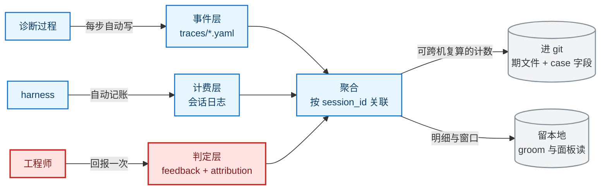

# 指标与反馈闭环的目标态

本文是这条闭环的**目标态**说明：诊断环与沉淀环产生的数据怎么采、怎么算、落到哪里，才能让「越用越准」这句话可以被核对。本文写的是设计，不是现状；哪一块已经落地、哪一块还是蓝图，在第 5 节逐块标出。

值得读的原因：这条链上有两处读数缺陷让指标恒等于 0 或静默归零（`scripts/trace_metrics.py:186`、`scripts/trace_metrics.py:240-243`），另有两处缺口让闭环拿不到输入：案例级被选中次数没有统计，改进项的实测记录没有落点。读本文能拿到「坏在哪、改成什么、为什么是这么改」三件事。

范围：数据的采集面、计算口径、落点归属与人介入的位置。不含三件事：诊断与沉淀两环内部的执行规则（在各自 skill 正文）、判据的具体数值（在 `metrics/gates.yaml` 与 `proposals/gates.yaml`）、取舍与被否决的方案（在 [ADR-0010](../adr/0010-metrics-feedback-target.md)）。

读者与前置：读者是要改指标、改 trace 字段、改周批流程或 groom 的人。前置是 [docs/guide/metrics.md](../guide/metrics.md)（现有指标怎么算）与 [skills/diagnose/references/diagnosis-trace.md](../../skills/diagnose/references/diagnosis-trace.md)（trace 写什么）。

改机制本身之前还要读 [rsi-mechanism.md](rsi-mechanism.md)。本文与它是同一层的两篇：它讲改进项怎么走，本文讲数据怎么来。

不必读的情形：只跑日常诊断、只想看面板趋势的人。这两类读者读 [docs/guide/metrics.md](../guide/metrics.md) 就够。

## 1 解决什么问题

这条闭环要解决的问题是：让每一次诊断和每一次沉淀留下可核对的数据，让数据算出读数，让读数触发改动，让改动被验证。数据、读数、改动、验证，缺任何一个，系统都退化成"看起来在学"。

现在缺的是数据层的一部分与读数层的正确性。诊断写下的信息里，检索候选与排除理由只存在于散文字段；算出来的读数里有两处结构性错误。

第一个环节：诊断过程写得很好，但**只有一部分能被机器算**。检索候选清单、排除理由、成本，都落在中文散文里（实例见 `traces/2026-09-13-dsv4-a3-moe-16419.yaml:138-142` 手写的候选 5 条）。采样面因此比写下的信息窄。

第三个环节：算出来的读数里，**有两处结构性错误让指标恒为 0 或静默归零**：

| 读数缺陷 | 位置 | 后果 |
|---|---|---|
| 误诊归因比只读 `verdict`，生产端写的是 `attribution_kind` | `scripts/trace_metrics.py:240-243`；`scripts/component_tally.py:56-57` 已实测记过"4 条事件、0 条含 verdict" | 即使有反馈，这条读数仍恒为 0 |
| 事件列表键名不是 `trace` 时按空处理 | `scripts/trace_metrics.py:186` | 该 trace 的读数归零但仍计入会话总数，静默稀释所有比例的分母 |

另外两处缺口：案例级「被选中次数」没有任何统计（`scripts/trace_metrics.py:285-296` 只计数不按案例聚合），于是 groom 的软退休判据（`skills/knowledge-groom/SKILL.md:92-94`）拿不到 `cold` 与 `tried-and-failed` 的区分；改进项的实测记录 `metrics/ev-measure-log.yaml` 有真实数据也有消费者，却没有进仓库的落点。

本文明确不解决的问题有四类：

- 不改诊断与沉淀两环内部的执行规则。那些规则在 `skills/diagnose/`、`skills/to-postmortem/` 的正文里，本文只覆盖数据面。
- 不引入向量检索，也不改现有的词法召回（理由见 [ADR-0002](../adr/0002-retrieval-no-rag-lightweight-index.md)）。
- 不做按人、按团队的使用与 KPI 类指标。触发条件未达（`docs/plan/roadmap.md:197-205`）。
- 不把每次诊断的指标单独开一个 PR 上仓。理由在第 3.6 节与 ADR-0010。

## 2 最小可执行模型

读懂这条闭环只需要抓住一件事：**一次诊断产生的数据分三层，三层的采样成本、可信度、落点各不相同。把三层混成一层，是现在多数毛病的共同来源。**

| 层 | 谁产生 | 采样成本 | 可信度 | 现在的落点 |
|---|---|---|---|---|
| 事件层 | diagnose 每步自动写 | 零，已经在写 | 中：agent 自报，但当场写 | `traces/*.yaml`，本地 |
| 判定层 | 工程师回报修复结果 | 一次人工交互 | 高：只有现场知道 | case 的 `confidence`，入 git |
| 计费层 | harness 记录提供方用量 | 零，已经在记 | 高：来自提供方账单 | DSH 会话日志，本地 |

三层之间靠 `session_id` 关联。目标态的做法是三条：

1. 事件层与计费层**全量自动采**，不要求人多做任何动作；
2. 判定层**只问一次，且问在修复生效的那一刻**，而不是下一次诊断启动时；
3. 聚合层只产出**可跨机复算的计数量**，不产出需要人来解释的读数。

第三条决定了整个落点设计：能被任意一台机器用同一份输入重算出来的数，才有资格进 git。

另一条判据，判断一个新指标该不该加，只问一句：**它触发什么不同的动作？** 答不出来就不加。这条判据在本文第 3.5 节用于筛掉所有"看起来有用"的指标。

## 3 完整机制

### 3.1 三层数据与它们的接口（构件）

**事件层**。每次诊断往 `traces/<session_id>.yaml` 追加一条 `{role, ...}`。目标态不动现有的事件结构，只做三件事：修上面那两处读取缺陷；把 `procedure_follow` 这条已经声明却没实现的读数补上；把 `attribution_kind` 与 `verdict` 两种写法收成一处。

事件层的写侧已经有 16 个 `action` 取值与配套词表（`skills/diagnose/references/diagnosis-trace.md:9-13`），不需要扩。新增字段的成本要单独论证。每加一个必填字段，都是在给一次分钟级的诊断加纪律。

**判定层**。判定层的唯一输入是人。现在这个通道的捕获率是三期 0（`metrics/timeline.d/2026-W37-live.yaml:33-36` 记 12 个会话无一人回报；`docs/plan/roadmap.md:138` 记前两期同样为 0）。

判定层的接口是 case 的两个字段块：`confidence{hits, misdiagnoses, score, last_hit}`（`docs/spec/case-schema.md:34`）与 `validation_record{consistent, inconsistent, self_consistent, last_verified}`（`docs/spec/case-schema.md:62-74`）。

目标态给 `confidence` 加一个 `partials` 计数，理由见 3.5 节第三条。

**计费层**。`scripts/session_cost.mjs` 已经能从 DSH 会话日志读出真实账单（未缓存输入、缓存读、缓存写、输出，按 turn 与 step 去重）。目标态**不把 token 写进 trace**，而是靠 `session_id` 与 step 号做关联。复制一份就要维护两份，且 trace 里那一份是自报值，不是账单。

三层的关系如下图。

**图 1　数据流（类型：流程图；范围：三层数据从产生到落点，以及人的介入点）**

图例：蓝色是自动发生，红色是人的动作，灰色是存储。判定层是唯一需要人的一层，事件层与计费层不要求人多做动作；聚合后的产物按"能不能跨机复算"分成两份，一份进 git，一份留本地。

### 3.2 一次诊断的数据流

结论：诊断期间不新增任何人工动作，只把已经能写的信息写全。

1. 建会话时写 `kb_rev`（`scripts/kb_rev.py` 的末行），之后不改。这一条已经在做，它让"当时库里有什么"可以被事后核对。
2. 每步按现有词表写事件，`output` 给用户、`reason` 记决策依据。检索候选清单继续写在 `reason` 里，**不把它改成结构化字段**，理由见 ADR-0010。
3. 收尾时写顶层 `stop_reason`、`feedback_pending_since`，并给出一条待回报的反馈项。
4. 报告产出后，在报告尾部与诊断对话的最后一段各留一行回报指令（3.3 节）。

诊断结束时，事件层已经自足：目标态下即使没有人回报，聚合层仍能算出路由准确率、覆盖缺口、流程加载与跟随、案例被选中次数、成本分布这五类读数。

### 3.3 一次反馈的数据流

结论：反馈要问在**修复生效的那一刻**，成本压到一次回车。

现在的问法有两个问题。一是问在错误的时间：追问发生在下一次诊断启动时（`rsi-mechanism.md` 的每周表第 1 行），而"上一次那个 fix 到底好没好"的记忆在两次诊断之间会衰减。二是问成了开放式选择：工程师要在三个取值里挑一个，还要回想是哪条 case。

目标态的问法：

1. **出口那一行**。报告与诊断对话的末尾给一句可复制的短指令，形如 `/skill:resume-diagnosis --feedback resolved`。工程师在问题刚解决时顺手回一句。
2. **入口那一行确认**。下一次诊断开屏时，如果有 `feedback_pending_since` 非空的会话，只显示一行预填确认，默认值取该会话最后一次给出的 fix 结果，回车即提交。不问第二个问题，不列 case 清单。
3. **不假定**。没有回答就保持 `pending`，聚合成"不可解读"，不按 `resolved` 计。判定层的可信来自"只有现场说了才算"，虚增一次就毁掉整条链的校准（原则十）。
4. **回答后立刻结算**。写 `feedback` 事件，`scripts/settle_trace_feedback.py` 结算进 case 的 `confidence`。结算仍按周批走一个知识修改 PR，不为此单独开 PR（`scripts/settle_trace_feedback.py:60-63` 已定）。

这一节的四条改动都不改 trace schema，落点分散在 `skills/diagnose/SKILL.md` 的追问节、`skills/resume-diagnosis/SKILL.md` 的开屏节与报告模板的尾部。

### 3.4 一次周批的数据流

结论：周批多加一段"把上一周的可复算计数写进期文件"，其余顺序不变。

现有五步（`docs/guide/metrics.md:149-165`）组一期骨架、体检、人复核、写源文件、重建聚合。目标态在其中插两步：

1. 组骨架时，新读数（案例被选中次数、导出标签计数、改进项实测计数）一并算出来写进骨架；
2. 落期时，把 `metrics/ev-measure-log.yaml` 的三个计数（本期实测次数、通过数、从未被测过的卡数）抄进期文件：这份流水有数据也有消费者，缺的只是落点。

groom 与周批是两条流程，现在互不引用：`skills/knowledge-groom/SKILL.md` 全文不含 `metrics/timeline.yaml`、`metrics_snapshot.py`、`verify_metrics.py`。目标态给它们的接缝加一条：groom 的开头读本期骨架里的越界清单，周批的收尾跑一次 `scripts/metrics_health.py` 把越界项交给 groom。两处各加一行，不合并两个流程。

### 3.5 三个新读数

结论：只加三个，都满足"零人工成本"与"触发不同动作"两条。

**第一条：案例被选中次数。** 从事件的 `hit.case`、`quickly_check.case`、`load_full.candidates`、`considered_candidates`、`excluded_cases` 算出每个案例的 `selected`（取过全文）、`considered`（看过没取）、`excluded`（排除）三个计数，窗口与 groom 现有的"近 12 周"一致，不新造常数。

动作：把 groom 的软退休判据从"靠感觉"变成两个可算的类别：`cold`（窗口内 `selected` 为 0，不退休，防止删掉罕见但正确的知识）与 `hot_unresolved`（`selected` 高而 `hits` 为 0，进复审）。这两个类别现在是定义写了、算不出来。

**第二条：导出标签。** 不新增人工枚举，从已经写下的数据导出：

| 标签 | 导出自 | 触发的动作 |
|---|---|---|
| `no_solution` | `miss` 事件 + `stop_reason` 为 `escalated_tier3` 或 `abandoned` | 新增案例、提炼新先验规则 |
| `conflicting_evidence` | `procedure_follow.conflict` 非空 | 修那条流程 |
| `misdiagnose_case` | 反馈非 `resolved` + 归因判为 case 错 | 改知识 YAML |
| `misdiagnose_execution` | 反馈非 `resolved` + 归因判为执行错 | 改 skill 正文 |
| `partial` | `feedback.outcome` 为 `partial` 且单独计数 | 补那条 case 的证据面 |

前四个动作已经在流程里（归因二分是原则八的落地），缺的是导出这一步没有脚本。第五个是真需要改判定的：`scripts/settle_trace_feedback.py:12` 现在把 `partial` 并进 `misdiagnoses`，而"内容对但不完整"与"这条知识错了"对排序的含义相反。

**第三条：拒绝率。** 从改进项卡的状态算：采纳、换方向、不采纳各多少。`rsi-mechanism.md:143` 已经写明这个读数的判据："不采纳一次都没有出现过，那么采纳记录不能单独用作质量结论"。现在的不采纳记录接近于零，现算方式是数 `proposals/ideas/*.yaml` 里 `status` 的取值分布。目标态只做**观测**：连续若干轮不采纳为 0 就报"拒绝域为空"，不设配额。设配额会诱导编造拒绝，那比没有拒绝更坏。

三个读数都不需要工程师多做任何动作，这是它们排在前面的原因。

### 3.6 落点与 git 归属

结论：落点按"能不能跨机复算"分两份，进 git 的那份不含客户原文。

| 产物 | 进 git | 为什么 |
|---|---|---|
| `traces/*.yaml` 与报告 | 否 | 含客户现场信息（`.gitignore:4-7`） |
| case 的 `confidence` / `validation_record` | 是 | 知识层的持久状态，是候选排序的输入 |
| `metrics/timeline.d/<期号>.yaml` | 是 | 一期一文件，各人各写不互撞 |
| `metrics/timeline.yaml` | 是，生成物 | 由 `scripts/build_timeline.py` 重建 |
| 案例被选中次数的窗口聚合 | 是，计数级 | 只写计数，不写案例与症状原文 |
| 改进项实测的三个计数 | 是，计数级 | 见 3.4 节 |
| 导出标签的明细 | 否 | 含 case 编号与结论，进期文件的只有计数 |

每次诊断的指标**不单独开 PR**。原因有三条：`traces/` 含客户数据不能进 git；生成物里不写数字是本仓库的硬约束；PR 量会从"每周一次"变成"每单一次"，而每周一次正是当前的门控节律。这条取舍的完整论证在 [ADR-0010](../adr/0010-metrics-feedback-target.md)。

## 4 边界与失败模式

结论：数据源缺席时，报"不可解读"，不写 0 当作满分。这条纪律在目标态下覆盖下列情形。

| 情形 | 机制的行为 |
|---|---|
| 仍然没有人回报反馈 | 命中率、误诊率、校准照旧标为不可解读；但事件层与计费层的五类读数照常产出，闭环不完全停摆 |
| 事件列表键名不认识 | 报"该会话事件未记录"并单列计数，比例读数旁标注分母里有几个不可读会话；不按 0 事件静默收下 |
| 归因事件用了 `attribution_kind` 写法 | 两种写法都收；`improvement` 与 `design` 不并进误诊，单列一桶 |
| 计费层日志缺失 | 该会话的成本缺席，不补估值 |
| 在 worktree 里跑周批 | `scripts/metrics_snapshot.py` 已有解析与来源标注；读不到时如实报"数据源不可达"，不产出空指标 |
| 某案例窗口内从未被选中 | 记为 `cold` 且不退休，不当作"无用" |
| 改进项实测记录从来没跑过 | 报"声明了可复现判据却未实测"，这一条现在有面板消费者，缺的是期文件落点 |

## 5 现状

### 5.1 已落地

- 事件层：16 个 `action` 取值与配套词表、证据落盘、`output` 与 `reason` 分层、`considered_candidates` 与 `parallel_group`、顶层 `stop_reason`、`kb_rev`。核对方式：`python3 scripts/trace_metrics.py --traces-dir traces` 报词表合规数与字段违规数。
- 判定层：`feedback` 事件与顶层 `feedback` 字段、结算进 case 的两个字段块、S2 通道单列。核对方式：`python3 scripts/settle_trace_feedback.py --audit`。
- 聚合层：现有指标的算法、期文件与生成物分离、体检器三态退出码、读入成本现算。核对方式：`python3 scripts/metrics_health.py --check`。
- 计费层：真实账单读取器。核对方式：`node scripts/session_cost.mjs --all`。

### 5.2 蓝图

- 第 3.3 节的反馈问法（出口一行、入口一行确认、不假定）。
- 第 3.5 节三个读数。
- `procedure_follow` 这条已声明指标的实现（`docs/guide/metrics.md:63` 有定义，`scripts/trace_metrics.py` 的指标表里没有该字段）。
- `metrics/ev-measure-log.yaml` 的期文件落点。
- 案例被选中次数的窗口聚合。
- 待定，附闸门：groom 变更摘要的仓库落点。它现在只存在于会话文本里，载体是 PR 描述加一个 groom 报告。按检查准入三条（机械可查、后果确定、复发至少两次），缺的是第三条：复发证据还没有，暂不立。

### 5.3 已否决

- 每次诊断的指标单独上仓。见 ADR-0010。
- 把检索的查询串、topK、分数写进 trace。见 ADR-0010。
- 把诊断标签扩成五个人工枚举。见 ADR-0010。
- 给 case 加 `status` 字段表达生命周期。见 ADR-0010。
- 把 token 与耗时写进 trace 事件。见 ADR-0010。
- 给"不采纳"设配额。见 ADR-0010。

## 6 代码与文档入口

| 用途 | 入口 |
|---|---|
| 现有指标怎么算 | `docs/guide/metrics.md` |
| trace 写什么 | `skills/diagnose/references/diagnosis-trace.md` |
| 事件侧读数 | `scripts/trace_metrics.py`（词表在 `:36-75`，违规检出在 `:188-266`，指标表在 `:337-377`） |
| 归因聚合 | `scripts/component_tally.py`（两套词表的映射在 `:88-96`） |
| 反馈结算 | `scripts/settle_trace_feedback.py` |
| 周批组装 | `scripts/metrics_snapshot.py` |
| 体检与判据 | `scripts/metrics_health.py`、`metrics/gates.yaml` |
| 成本账单 | `scripts/session_cost.mjs` |
| skill 级成本 | `metrics/skill-exec-log.yaml`、`scripts/log_skill_exec.py` |
| 改进项实测记录 | `metrics/ev-measure-log.yaml`、`scripts/ev_measure.py` |
| 改进项状态与判据 | `proposals/gates.yaml`、`scripts/evolution_health.py` |
| 机制层 | `docs/mechanism/rsi-mechanism.md` |

## 7 外部参考

无。这条闭环的设计引用都在仓库内：原则八（可观测先于改进）、原则九（稀缺资源显式预算）、原则十（诚实退化）。外部研究的适用性判断见 `docs/mechanism/rsi-mechanism.md` 最后一节，本文不另列。
