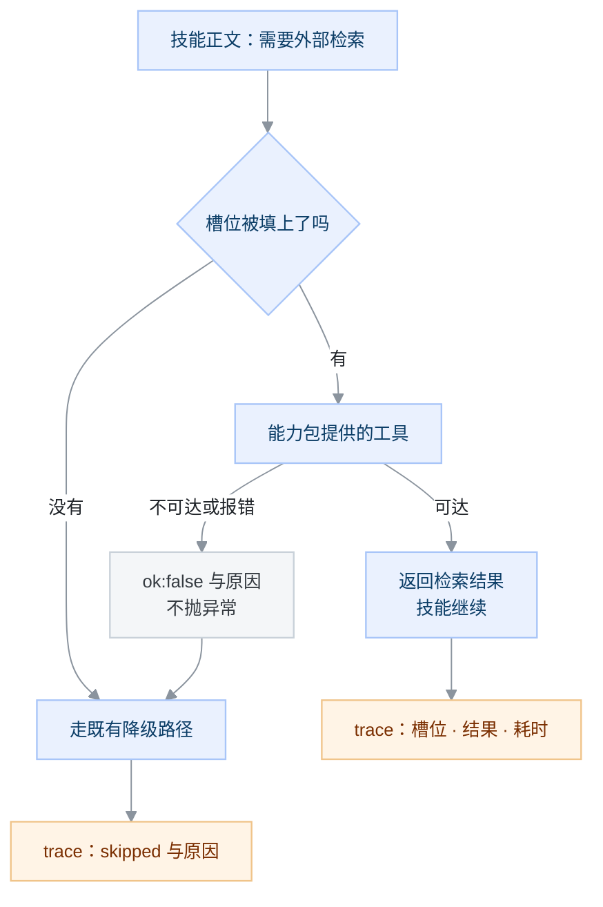
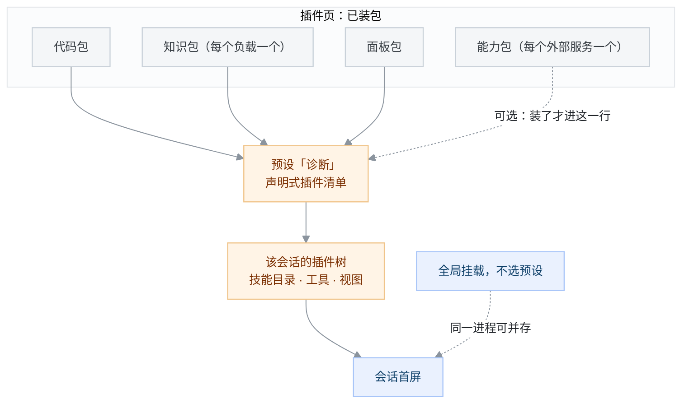
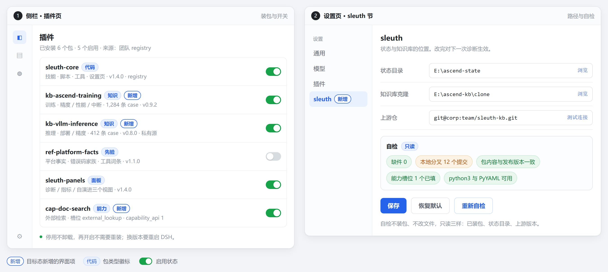
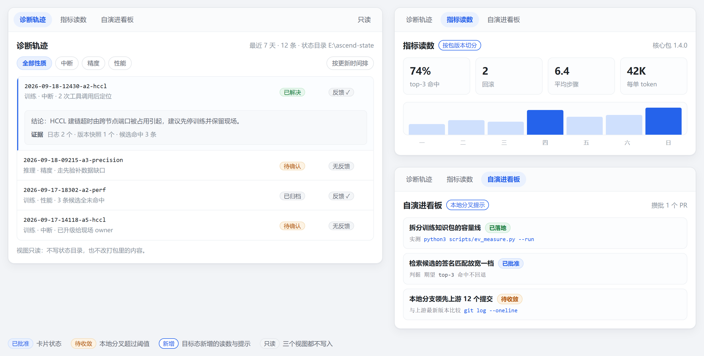
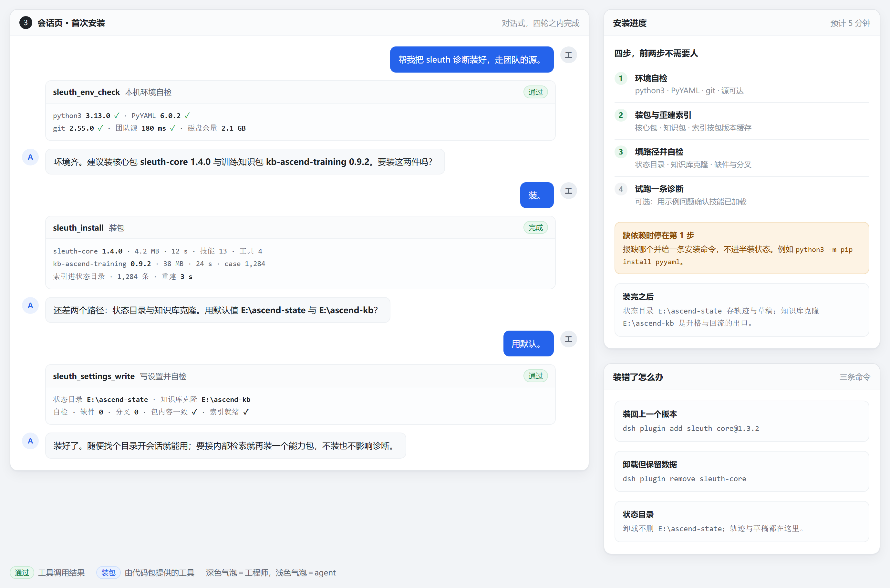
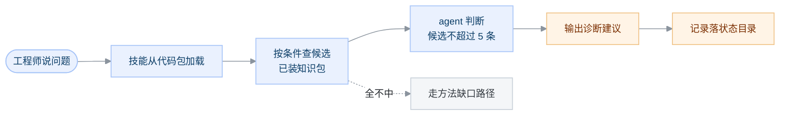
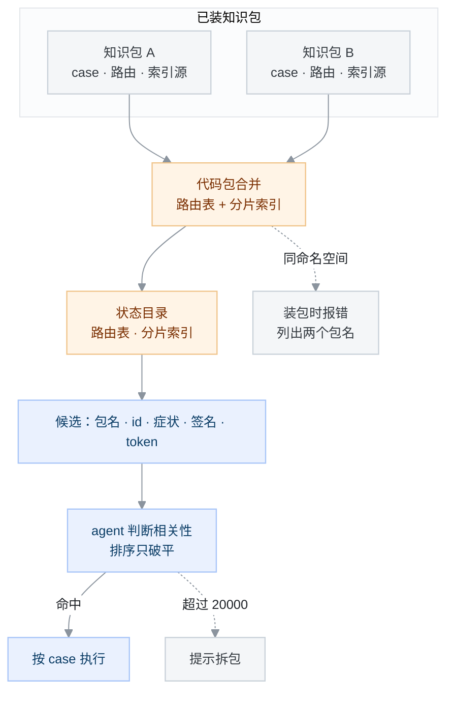
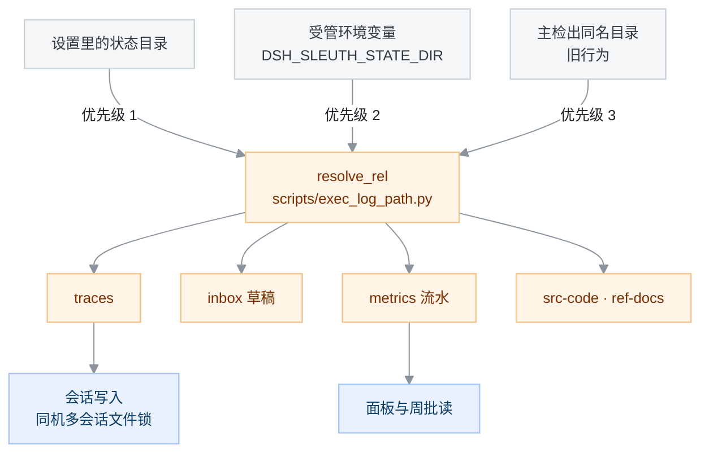
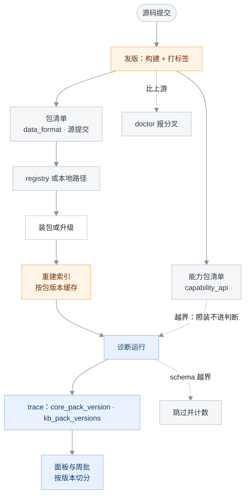
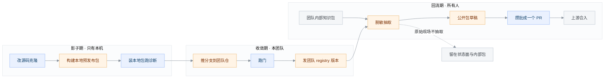

# 提案：把 ascend-sleuth 改成插件组合形态

本文提出把 ascend-sleuth 的代码与知识改成以 DSH（DeepSeek Harness）插件包分发，会话工作区只承载工程师当天手头的资料。范围覆盖目标形态、安装与使用、多包组合、版本协作、演进与回流、迁移、边界情形，以及要改与不改的部分；不涉及诊断流程本身与 case 字段语义。读者是要评审这项改动的人，先读[设计原则](../docs/spec/design-principles.md)与 [git 工作流](../docs/guide/git-workflow.md) 的部署形态一节。只跑单次诊断、不关心分发形态的使用者不必读。

状态：提议（尚未评审；批准后在此补决议链接）

本文用三个自定术语，首次出现处定义一次，后文只用这三个词：

- **代码面、知识面、状态面、源面**：按「谁写、谁管版本、放在哪」把系统里的材料分成四类，见「方案」的第一小节。
- **完全插件化**：代码与知识全部以插件包分发，工作区不再承载系统结构。
- **回流**：把本地或团队私有的知识条目，按白名单抽成可公开形态，提交回上游仓。

## 动机

现在每次使用都从一次 `git clone` 开始。工程师把整仓拉到本地，`.dsh/skills` 指向 `skills/`，agent 从检出里发现技能，脚本按检出内的相对路径读写。代码、知识、评测、面板、CI 全在这一个检出里。这个形态带来四项代价，按出现频率排。

1. 只用诊断的人也要拉整仓。诊断用到的是 `skills/diagnose/` 与 `knowledge/` 的一部分，实际要拉下来的是 13 个技能、75 个脚本、两个面板与 12 个 CI 作业。
2. 私有知识没有分发粒度。`knowledge/` 与 `postmortems/` 含客户数据（`.gitignore` 的注释写明），要私有只能 fork 整仓；反过来，团队想只给同事装一份私有知识库，没有可给的单位。
3. 运行时产物与检出绑定。`traces/`、`postmortems/inbox/`、`metrics/` 的流水都靠 `scripts/exec_log_path.py` 解析到「主检出」。换机器、换目录、清理一次 worktree，历史读数就跟着断（`scripts/shared_dir.py` 的注释记的就是这条丢失路径）。
4. 升级与保住本地知识是同一个动作。知识在同一仓里时，`git pull` 既更新方法论也覆盖本地案例，使用者只能二选一，多数人选择不升级。

Windows 上还多一层成本：`.dsh/skills` 是 git 跟踪的相对符号链接，clone 后可能落成 9 字节文本文件，agent 发现不了技能。[windows-setup.md](../docs/guide/windows-setup.md) 整篇在处理这一件事。

## 目标

做完之后，下面五件事成立，每件都能用一条命令或一次观察确认。这一节描述的就是完全插件化。

| 变化 | 怎么确认 |
|---|---|
| 不 clone 也能诊断 | 装一个代码包与一个知识包，在任意目录开会话跑通一次诊断 |
| 知识按包拆装 | 同一台机器装两个知识包，`pack_status` 列出两个包与各自条数 |
| 运行时产物与工作区解耦 | 换个工作区再诊断，旧 trace 仍出现在面板里 |
| 升级与回滚是版本操作 | 装新版本后行为变化可复现；装回旧版本后恢复 |
| 团队私有知识留在自己仓 | 私有仓与公开仓各自发布，公开包只含通过脱敏抽取的条目 |

## 非目标

下面五件本来可以是目标，这次明确不做，每条写明理由。

1. 不把知识库的 git 仓插件化。知识的产出是 PR，评审门（双签、CODEOWNERS 目录归属、封存对照集）只存在于仓上。包是分发单位，仓是评审单位，两者不合并。
2. 不做多机共享的状态目录。状态面要放网络盘或对象存储，锁的语义就不可靠，读数会在并发写里互相覆盖。当前只保证单机单用户正确，跨机共享留给需要它的人另开提案。
3. 不改检索方式。三层检索与词法候选排序保持不变（[ADR-0002](../docs/adr/0002-retrieval-no-rag-lightweight-index.md) 的结论仍然有效）。这次只改索引由谁生成、放在哪。
4. 不改 case 字段语义与诊断流程。技能正文的步骤、判据、输出格式不动，改的只是正文里写路径的那几处。
5. 不为别的 agent 宿主出插件版。Codex、Claude Code 一类继续按目录形态用 `skills/`。插件形态只服务 DSH。

## 方案

### 5.1 四个面

先把材料按「谁写、谁管版本、放在哪」分成四类，后面所有决定都落在这四类上。

| 面 | 放什么 | 版本由谁定 | 物理位置 | 谁写 |
|---|---|---|---|---|
| 代码面 | 13 个技能、75 个脚本、两个面板、四个工具、设置页 | 插件包版本 | profile 的 `node_modules` | 发布流水线 |
| 知识面 | `knowledge/`、`references/`、路由片段、索引源 | 知识包版本 | 同上，安装后只读 | PR 合入后发布 |
| 状态面 | `traces/`、inbox 草稿、指标流水、源码缓存、文档缓存 | 不版本化 | 设置里指定的目录 | 运行期 |
| 源面 | 知识库的 git 仓（升格与回流的出口） | git 提交 | 插件托管的一份克隆 | 知识整理流程 |

这张表能成立，靠 DSH 的三条既有能力：

- 插件可以提供技能。DSH 自带的 `dsh-ppt` 包用 `ctx.skills.registerProvider()` 注册了一个技能，正文放在包内 `skills/dsh-ppt/SKILL.md`。同一接口对第三方包开放（见 DSH 安装目录内 `@deepseek-ai/dsh-skill` 的说明）。
- 安装单位是包，来源有四种。插件管理器接受 registry 包名、绝对路径、git 地址、tarball；私有 registry 只问它自己，不回落公共源。装失败会恢复 `package.json` 与锁文件，生效按代原子替换（见 DSH 安装目录内 `@deepseek-ai/dsh-plugin-manager` 的说明）。
- 技能的发现根可配。技能提供方按根扫描，项目根、用户根、自定义目录与随包根各有优先级（见 DSH 安装目录内 `@deepseek-ai/dsh-skill-filesystem` 的说明）。所以包内的 `skills/` 能被发现，不需要往工作区放符号链接。

包怎么切：

| 包 | 内容 | 装给谁 |
|---|---|---|
| 代码包（一个） | 技能、脚本、面板、工具、设置页 | 所有人 |
| 知识包（每类一个） | 某个负载或框架下的 case、路由片段、索引源 | 按需 |
| 先验包（每类一个） | 平台事实、错误码家族、工具词条、方法论 | 按需 |
| 能力包（每个外部服务一个） | 检索、源码查询、截图转文字这类外部能力 | 需要它的人 |
| 面板包（可选） | 诊断、指标、自演进三个视图 | 想看界面的人 |

代码包与知识包分开的理由只有一条：知识有私有面，代码没有。两者装在一个包里，私有化就没有粒度。

能力包是外部服务的接入件，仓里 `dsh-plugins/dsh-sleuth-vllm-kb/` 就是第一例。它与代码包有四条约定：

1. 代码包只声明能力槽位（例如「外部检索」），不写具体服务的工具名与地址。技能正文判断的是槽位有没有被填上。
2. 能力包注册工具、自带设置节，安装与卸载互不影响代码包版本。
3. 拿不到服务时工具返回 `{ok:false, reason}`，不抛异常；技能按既有降级路径继续，trace 记一行跳过的原因。
4. 能力包在清单里声明它实现的槽位与契约版本，`pack_status` 把两者都列出来，避免「装了但流程不认识」。

接入与降级见下图。槽位空着时行为与今天一致。

图 1　能力包接入与降级（类型：流程图；范围：一次外部检索调用；省略了重试、超时与鉴权参数）

图例：蓝色是流程判断，橙色是写进 trace 的记录，灰色是失败分支。槽位没有填上时走今天已有的降级路径，行为不变。

一次诊断里四个面的调用顺序是固定的：

1. 代码包提供技能与工具，模型按技能正文执行。
2. 知识面按正文里的查询条件取候选，候选来自已装的知识包。
3. 状态面接住过程记录与草稿。
4. 升格与回流只碰源面，不碰已安装的包。

包的启用与停用走 DSH 插件页的逐行开关，停用不卸载，下次开启不需要重装。

装包之外还有一层选择：把行列进 profile 的全局挂载，或按预设挂载。预设是 DSH 的声明式插件清单，注册表按它创建隔离的插件树，会话按预设 ID 挂载，同一进程可以并存多种组合。本方案用它收窄会话的上下文范围，不用它做隔离（见 DSH 安装目录内 `@deepseek-ai/dsh-agent-preset-registry` 的说明）。

使能分三步：

1. 装包：预设随 bundle 下发，bundle 里插一行 `@deepseek-ai/dsh-agent-preset` 声明，装包时一起写进 profile。
2. 选预设：新会话在预设选择器里选「诊断」。已有会话保留创建时的组合，不跟着变。
3. 换组合：改声明再装一次。覆盖是整份替换，不合并内置清单的未来更新。

只发一个预设「诊断」，不发「每个能力一个预设」：条数越多，覆盖与升级的对照成本越高。

图 2　预设与组件的集成（类型：组合图；范围：一个预设的挂载路径；省略了预设内各行的启用状态与覆盖规则）

图例：灰色是已装的包，橙色是预设与它生成的插件树，蓝色是会话；虚线表示可选或并存的路径。预设只决定挂载哪些行，不做隔离。

### 5.2 用户面：三档与三次交互

使用者的能力需求分三档，装什么由档位决定。

| 档 | 机器上要有 | 能做什么 |
|---|---|---|
| 只诊断 | DSH、python3、PyYAML | 装代码包与一个知识包，跑诊断，产物落状态目录 |
| 沉淀 | 再加 git | 升格草稿、提 PR、跑回流抽取 |
| 演进 | 再加私有 registry 的发布权 | 改源码、本地装预发布包、发团队版本 |

整个生命周期只有三次交互。

1. 首次安装（约 5 分钟）：装代码包、装需要的知识包，在设置页填两项：状态目录、知识库克隆路径。沉淀档再加一项上游仓地址。缺 python3 或 PyYAML 时，安装命令直接报缺哪个，不用等第一次诊断才失败。
2. 日常：在任意目录开会话，说问题。技能从代码包发现，知识从已装的知识包读，产物落到状态目录。工作区里只出现工程师自己放的文件。
3. 收尾：沉淀流程把草稿写进状态目录的 inbox；周批的知识整理把草稿升格进源面的克隆并提 PR；`doctor` 报缺件与分叉。

安装与配置分散在两处界面：插件页管装包与开关，设置页管路径与自检。

图 3　安装与配置界面（类型：界面设计稿；范围：侧栏插件页与设置页的 sleuth 节；新增项以蓝框「新增」标出）

图例：蓝框「新增」是目标态新增的界面项，其余元素沿用现有 DSH 界面。自检只读三样，不装包也不改文件。

使用界面是会话页的三个只读 tab：诊断轨迹、指标读数、自演进看板。

图 4　会话页三个面板（类型：界面设计稿；范围：三个 tab 的首屏；省略了空状态与错误状态）

图例：蓝框「新增」标出目标态新增的读数与提示；三个视图都不写状态目录。

第一次装好只需要四轮对话，装了什么、自检读了什么都在工具卡片里。

图 5　首次安装的对话流程（类型：界面设计稿；范围：四轮对话与右侧的进度卡；省略了网络失败与权限不足的分支）

图例：深色气泡是工程师，浅色气泡是 agent，工具卡片标出实际装了什么、自检读了什么。缺依赖时停在第 1 步，不进半装状态。

一次会话里，四个面按固定顺序被用到，见下图。

图 6　一次会话的交互顺序：技能、知识包、状态目录分别在什么时候被用到（类型：流程图；范围：一次诊断的会话内；省略了工具调用的具体次数）

图例：蓝色是会话内的步骤，橙色是产出，灰色是候选全不中时的降级路径。实线是主路径，虚线是降级路径；降级路径的行为与今天的检出形态一致。

产物落点：

| 产物 | 落点 | 生命周期 |
|---|---|---|
| 诊断轨迹 | 状态目录的 `traces/` | 长期，含客户信息，不上仓 |
| 沉淀草稿 | 状态目录的 inbox | 升格后清空 |
| 执行流水与实测记录 | 状态目录的 `metrics/` | 长期，供面板与周批读 |
| 上游源码缓存 | 状态目录的 `src-code/` | 可按版本清理 |
| 上游文档缓存 | 状态目录的 `ref-docs/` | 按来源提交保留 |

上面默认所有会话都能用到 sleuth。若不想让无关会话背上 13 个技能描述的上下文成本，改用「诊断」预设挂载；预设怎么下发、怎么选、组件怎么进预设，见 5.1 的预设一段。

### 5.3 知识面：多个包怎么合并

装第二个知识包之前必须先定合并规则，否则第二个包装上就会出问题。规则五条。

1. 路由词按包追加。每个知识包带一份路由片段，代码包在装包与启动时把片段合并成一份路由表，写进状态目录。仓库里 `triage-tree.d/` 一性质一文件、聚合文件配 `merge=union` 的写法，正好是片段的形状（[CLAUDE.md](../CLAUDE.md) 的并发提交一条）。
2. 同一个命名空间被两个包声明即报错。报错信息列出两个包名，不猜谁优先。命名空间的归属是知识包之间的边界，靠运气解析会让同一条 case 分不到确定的路径。
3. 同一个 case id 出现在两个包：按包清单里声明的 `priority` 取高者，另一条在 `pack_status` 里列出。默认 `priority` 相同即按上面一条报错。
4. 候选仍由 agent 判断相关性。跨包的候选查询返回（包名、case id、首条症状、签名、token 数），排序只用来破平，规则沿用 `scripts/rank_candidates.py`。这条不改，是因为历史回放里 agent 的判断优于任何机械排序键（[CLAUDE.md](../CLAUDE.md) 的三层知识加载一条）。
5. 容量按包报，合计只提示。每个包各自算读侧 token 成本，软 8000、硬 20000 两条线沿用 [metrics/gates.yaml](../metrics/gates.yaml)。跨包合计超过 20000 的硬线时提示拆包，不硬拦。

路由与索引从包走到候选的路径，见下图。

图 7　多包合并：路由与索引怎么从包变成候选（类型：数据流图；范围：装包与一次候选查询；省略了包版本与缓存命中细节）

图例：灰色是输入与兜底，橙色是生成物，蓝色是判断与执行。冲突在两个知识包被合并的那一刻报出，不等到候选取不到结果才报。

### 5.4 状态面：路径、并发、缺件

路径解析按三层优先级取值，从高到低：设置里的状态目录 → 插件注册的受管环境变量 → 旧行为（主检出的同名目录）。

图 8　状态目录的路径解析：三个来源与四个消费方（类型：分层图；范围：运行时件的读写路径；省略了每个文件各自的写锁实现）

图例：灰色是候选来源，橙色是解析结果与产物目录，蓝色是写侧与读侧。来源从上到下依次尝试，前一层取到值就不再往下走。

- 只改一个地方。`scripts/exec_log_path.py` 的 `resolve_rel` 是全部共享运行时件的解析入口，`scripts/shared_dir.py` 是它对外的命令行。来源加在 `resolve_rel` 里，75 个脚本不用逐个改。
- 技能不再自己拼路径。代码包注册三个受管环境变量，`DSH_SLEUTH_STATE_DIR`、`DSH_SLEUTH_KB_DIR`、`DSH_SLEUTH_SCRIPTS_DIR`。DSH 允许插件注册 shell 环境事实。另提供一个 `sleuth_paths` 工具打印解析表。技能正文里写 `$DSH_SLEUTH_STATE_DIR/traces`，不写相对路径。

并发：同机多会话仍用文件锁，锁的对象从「主检出里的文件」变成「状态目录里的文件」，语义不变。不同机器各写各的，不做合并。

边界情形与处置：

| 情形 | 处置 |
|---|---|
| 索引在装包时生成失败（缺 PyYAML） | 安装即失败并报缺哪个依赖，不进半装状态 |
| 知识包卸载后，trace 仍引用该包的 case | 面板按「缺件」显示条数，不显数字 0，也不拿别的包顶替 |
| 状态目录被删或不可写 | `doctor` 报出来并给默认路径；写失败时报具体路径，不静默改道 |
| 同一个包被手动改过内容 | 下次装包覆盖，`doctor` 报「包内容与发布版本不一致」 |
| 换机器（状态目录没跟过来） | 面板显示「本次没记」，不显示 0 |
| 装回旧版本后索引格式变化 | 索引由代码包重建，旧包内容读不出来时按未知 schema 跳过并计数 |

### 5.5 版本协作

版本协作只引入两个整数字段，不引入版本协商协议。

- 两个整数字段：包清单里的 `data_format` 表示这个包的索引源格式；每条 case 里的 `schema` 表示这条数据的字段版本。两者都是整数。
- 索引不随知识包发布。知识包只带源数据，代码包在装包与版本变化时从源数据重建索引，写进状态目录并按包版本缓存。这样索引格式不跨包，格式错配这一类问题不存在。
- 未知 schema 跳过并计数。遇到高于自己支持版本的 case，跳过它并记一笔，在 `pack_status` 里报「N 条 case 的 schema 高于本插件」。不失败、不阻塞诊断，与 `compat` 软匹配同一条原则。
- 诊断记版本。trace 顶层从单一的 `kb_rev` 扩成 `core_pack_version` 与 `kb_pack_versions`。不记这两个，面板与周批会把两个版本的数据混在一起算，读出的「改进有效」无法解释。
- 分叉可读。包里记构建来源提交，`doctor` 对比上游最新版本报分叉程度。默认不锁版本，理由见「未决问题」。
- 能力包的契约版本。能力包清单里写 `capability_api` 整数，代码包接受一个区间。不在区间内的能力包照装但不进技能判断，`pack_status` 报一条。

从提交到读数的链路，见下图。

图 9　版本协作：从提交到读数的链路（类型：流程图；范围：一次发版到一次诊断；省略了回滚操作与 registry 认证）

图例：灰色是输入与兜底，橙色是生成与派生，蓝色是运行与读数。两个整数分别在发版（`data_format`）与数据写入（`schema`）时确定，诊断只读不协商。

### 5.6 演进与回流

演进走三段，每段的单位与出口不同。

| 段 | 谁受益 | 做什么 | 出口 |
|---|---|---|---|
| 影子期 | 只有本机 | 改源码克隆，构建本地预发布包，装上跑真实诊断 | 本地包 |
| 收敛期 | 本团队 | 推分支到团队仓，跑门，发团队 registry 版本 | 团队包版本 |
| 回流期 | 所有人 | 把可公开部分攒批成一个 PR | 上游合入 |

三段之间的衔接与双包产出，见下图。

图 10　演进与回流的三段与双包（类型：流程图；范围：一个团队从改源码到回流上游；省略了门的具体条目与脱敏白名单字段）

图例：蓝色是人工动作，橙色是产出，灰色是知识载体。三段可以各自停留；只有第三段的产物进上游，前两段只影响本机与本团队。

知识回流按三层内容分开处理，这是与「私有知识不外流」这条既有约定的衔接点。

| 内容 | 含不含客户现场 | 回流方式 |
|---|---|---|
| 先验词条 | 不含 | 全量回流，直接 PR。`references/` 本来就是公开面 |
| case 外壳（症状、签名、root_cause、fix、platforms、compat、severity） | 不含，只要不抄现场 | 按白名单抽成公开形态后回流 |
| 原始现场（trace、postmortem 原文、日志、路径、客户名） | 含 | 不回流，只在状态面与私有知识包 |

可公开形态由一条流水线从私有知识包抽出来，产出两个知识包：团队内部包与公开包。三件配套：

1. 白名单是一份数据，不是写在技能正文里的纪律。保留哪些字段、剔除哪些字段各列一张表。
2. 抽取脚本只出草稿，输出「抽了哪些、整条拦下哪些、为什么拦」，不直接提交。
3. 机检门扫新增的公开条目：内网域名、主机名、绝对路径、客户名表，命中即红。脱敏本身是判断，机检只负责把该看的三行摆到人面前。

三条边界不许让步：门可以本地跑，但封存对照集的重封只认维护者；版本必须进读数；本地分叉超过阈值必须提示收敛。

### 5.7 要改与不改

要改的地方到文件。

| 位置 | 改什么 |
|---|---|
| `scripts/exec_log_path.py` 的 `resolve_rel` | 增加两个来源：设置里的状态根、受管环境变量 |
| `scripts/shared_dir.py` | 输出解析来源，供 agent 与人核对 |
| 18 处 `Path(__file__).parent.parent` 默认值 | 改成走统一解析，代码根与知识根分开 |
| `scripts/build_index.py` | 输出根可控，支持写进状态目录并按包分片 |
| `skills/diagnose/SKILL.md` 里提到路径的 30 行 | 换成环境变量或 `sleuth_paths` 的输出，正文不写相对路径 |
| `dsh-plugins/` 下的面板 host | 去掉 `git rev-parse` 依赖，改读设置 |
| 打包清单（新增） | 目录到包的映射、生成物声明、版本推导 |

不改的地方同样明确。

| 不改 | 理由 |
|---|---|
| case 字段与语义 | 这次只动分发与路径，字段变更另有提案 |
| 三层检索与索引字段顺序 | ADR-0002 的结论仍然有效 |
| 五条流程的步骤与产物形态 | 诊断、沉淀、升格、摄取、演进的行为不变 |
| 12 个 CI 作业的内容 | 内容门留在 PR，新增的只有发布门 |
| 面板的信息架构与文案 | 除数据来源外不动 |

## 替代方案

**方案甲：保持检出式，只把运行时件的路径做成可配置。** 好处是改动最小，一周内能上。坏处是私有知识的粒度问题与升级覆盖本地知识的问题都不解决，Windows 的符号链接问题也还在。不选的理由：它只解决第四项动机的一半。它可以作为迁移的第一个阶段，不作为目标形态。

**方案乙：每个插件一个独立 git 仓。** 好处是权限与私有性天然隔离，一个仓可以只给一个团队。坏处是跨仓对账变成日常：技能正文与脚本、索引与路由分居不同的仓，每次改动要同步两三个 PR。还有一条更硬的限制：pnpm 不支持安装 git 仓的子目录，见 [pnpm issue #7483](https://github.com/pnpm/pnpm/issues/7483)。单仓多包因此无法直装，多仓就意味着每个包一次发布。不选的理由：当前这批内容由同一批人同步维护，拆仓把合并成本换成版本成本，净亏。

**方案丙：用会话内动态插件承载全部功能，不装包。** 好处是不需要安装与版本管理，改完立刻生效。坏处是会话结束就消失，无法持久化；新版本 DSH 也不再向模型暴露动态定义入口。不选的理由：它适合试验，不适合分发。影子期可以用它做小实验，正式形态必须落成包。

## 代价与缺点

1. 支持面变大。包版本、知识包组合、DSH 版本三者交叉，用户报问题时先要确认组合。缓解办法是把组合写进 `doctor` 的输出，但报障沟通成本仍会上升。
2. 发布门变重。12 个 CI 作业之外多出构建、生成物一致性、可加载性、跨包格式四道门，只在发布时跑，但需要有人维护这条流水线。
3. 首屏技能成本随包增长。技能目录每次会话整份进入模型上下文，装的知识包若附带自己的技能，技能数量会涨。当前 13 个技能已是既有成本，拆包会把它变成变量（见「未决问题」）。
4. 本地演进产生分叉。影子期越顺手，分叉越容易长期不收敛，团队经验回流变少。缓解是 `doctor` 报分叉，但这是提示不是强制。
5. 脱敏抽取需要持续人力。脚本能省「从零判断」，省不掉每批复核。按一周一批估，每批 30 到 60 分钟。
6. 状态目录在工作区外时有写权限问题。`workspace-write` 模式下模型只能写工作区内，读不受限。沙箱策略也不提供额外的可写根（见 DSH 安装目录内 `@deepseek-ai/dsh-fs-sandbox` 与 `dsh-sandbox-policy` 的说明）。两条出路：产物改由插件工具写，或把这类使用者的默认档设成 `danger-full-access`。前者更稳，但要改轨迹的写入方式。
7. 过渡期两套根并存。脚本要同时支持「检出内相对路径」与「设置里的绝对路径」，面板两套都要能读。过渡期复杂度集中在这里，剥离时容易留下半套。

## 依赖与新增的运维工作

依赖四项，按先后排：

1. DSH 版本下限。需要 `plugin_manager` 的装包能力、技能提供方注册接口、shell 环境事实注册接口。装包时的 peer 范围检查由管理器负责，代码包在 `peerDependencies` 里声明。
2. 私有 registry。团队包与知识包的发版出口。没有 registry 时退路是 git 直装，但那只适合单包仓。
3. python3 与 PyYAML。装包时重建索引要用。缺了在安装阶段就失败。
4. git 与 PR 工具。只在沉淀与演进档需要。

迁移按五步走，每步可独立验收：

1. 双轨期：代码包与现有检出并存。检测到检出就按旧行为跑，检测不到就用设置。
2. 路径切换：`resolve_rel` 加设置来源，`shared_dir` 输出来源；这一步不改变任何默认值。
3. 装包验证：内部先装一次代码包与一个知识包，跑通一次诊断与一次升格，记录缺件。
4. 试点团队：一个团队用内部包与私有知识包跑两周，收集报障与分叉情况。
5. 剥离检出：把检出模式降级为兼容路径，下一版删除。

新增的运维工作四项：发版与版本一致性检查；registry 权限与审计；周批回流复核；分叉与包内容一致性监控。

## 未决问题

本节不构成实现依据。已定的写在方案里，未定的集中在这里。

1. 团队要不要锁知识包版本。倾向先不锁，等出现「两人读数不一致」再锁。锁早了会挡住回流。
2. 多机共享状态目录要不要做。当前明确不做，但接口要留。留到什么程度未定。
3. registry 选型与命名空间。用现成的私有 registry 还是新搭一套，命名空间怎么分（代码、知识、先验三类是否同前缀）。
4. 知识包附带技能时，首屏成本怎么控。是按包默认关闭、按需开启，还是限制每个包最多贡献一个技能。
5. 旧检出用户的剥离时点。双轨保留几个版本周期，怎么通知。
6. 轨迹写入方式要不要改成工具。与「代价与缺点」第 6 条绑定：改成工具写就没有工作区外的写权限问题，但会限制 agent 自由书写正文的空间。

## 先例

- DSH 自带的 `dsh-ppt` 包：包内放 `skills/dsh-ppt/SKILL.md`，用技能提供方接口注册，正文与模板资源随包分发。本提案的技能分发方式与它同一条路。
- VS Code 扩展市场：一个扩展一个包，能力（语言、主题、命令）由包声明，版本与宿主版本有兼容范围。知识包与代码包的分工与之类似。
- npm workspaces：单仓多包，按包各自发布与各自版本。本提案的仓库形态取这一条。
- Homebrew tap：私有源与公共源并存，装哪个源由用户决定。私有知识包与公开知识包的关系取这一条。
